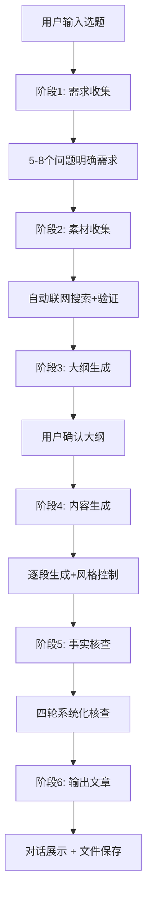

# 远川商业写作大师 - 智能文章自动生成器

> **AI智能生成8000-10000字远川风格商业分析文章**  
> 用户输入选题 → 自动搜索素材 → 智能生成完整文章 → 自动事实核查 → 完成交付

---

## 🎯 核心功能

### ✨ 一句话启动，完整文章自动生成

```
我想写一篇关于[公司名/事件/趋势]的商业分析文章
```

**系统自动完成**：
1. ✅ 详细需求收集（5-8个问题明确方向）
2. ✅ 联网自动搜索（企业财报、行业报告、深度报道）
3. ✅ 智能大纲生成（结构化框架+字数分配）
4. ✅ 完整文章生成（8000-10000字，远川风格）
5. ✅ 自动事实核查（四轮核查，多源验证）
6. ✅ 双模式输出（对话展示+文件保存）

### 🎨 远川风格完美复刻

- **数据艺术化**："2710亿元" → "相当于每天赚7.4亿元"
- **节奏掌控**：7:3长短句配比，4:6紧松节奏
- **金句点睛**：每800字1个金句，全文2-4个
- **哲理升华**：从个案到行业规律的思考

### 🔍 严格事实核查

- **四轮核查法**：数据→时间线→实体→引用
- **多源验证**：交叉比对，单一信源标记
- **信源分级**：5级评估（⭐⭐⭐⭐⭐财报 → ⭐自媒体）
- **自动修正**：明确错误自动修正

---

## 📊 生成级别

| 级别 | 字数 | 时间 | 适用场景 |
|------|------|------|----------|
| 基础版 | 5000-6000字 | 3-4小时 | 快速解读、时效性选题 |
| 进阶版 ⭐ | 8000-10000字 | 6-8小时 | 深度分析、综合研究（推荐）|
| 专业版 | 10000+字 | 2-3天 | 专业研究、权威报告 |

---

## 🚀 完整工作流程



---

## 💡 使用示例

### 示例1：小米汽车分析

```
👤 我想写一篇关于小米汽车的商业分析文章

🤖 【阶段1: 需求收集】
您想研究的对象是: 小米汽车
✅ 已识别: 单一公司 | 新能源汽车行业

请选择生成级别:
a) 基础版 (5000-6000字, 3-4小时)
b) 进阶版 (8000-10000字, 6-8小时) ⭐ 推荐
c) 专业版 (10000+字, 2-3天)

👤 b

🤖 您最关心什么问题?(可多选)
a) 商业模式  b) 竞争优势  c) 发展历程  
d) 面临困境  e) 未来趋势

👤 a,b

🤖 【阶段2: 素材收集】
🔍 自动搜索中...
✅ 基础信息收集完成
✅ 核心数据收集完成 (27个数据点)
✅ 深度文章收集完成 (15篇)

【阶段3: 大纲生成】
📋 已生成详细大纲:

标题: 小米汽车亏本卖,雷军到底在下什么棋？

一、开篇引子 (300字)
二、背景铺陈 (700字)
三、正文模块1: 第一层逻辑 (1400字)
四、正文模块2: 第二层逻辑 (1300字)
五、正文模块3: 第三层逻辑 (1500字)
六、风险与挑战 (1000字)
七、结尾升华 (500字)

预计字数: 8500字

是否确认? (y/n)

👤 y

🤖 【阶段4: 内容生成】
🚀 开始生成...
✅ [1/5] 背景铺陈 (720字) 已完成
✅ [2/5] 正文模块1 (1350字) 已完成
⏳ [3/5] 正文模块2 生成中...

【阶段5: 事实核查】
🔍 四轮核查中...
✅ 数据核查: 23个数据点, 2个需修正
✅ 时间线核查: 15个时间点, 全部通过
✅ 实体核查: 20个实体, 全部通过
✅ 引用核查: 23处引用, 2处需补充来源

🔧 自动修正完成
📚 参考文献已生成 (12条)

【阶段6: 输出文章】
✅ 文章生成完成!

📊 统计:
- 总字数: 8520字
- 阅读时长: 11分钟
- 数据点: 27个 (已验证100%)
- 参考文献: 12条

[完整文章内容...]

💾 已保存: 小米汽车_战略分析_20250128.md
```

---

## 📚 核心知识库

本Skill基于6万字深度写作方法论构建:

| 文件 | 内容 |
|------|------|
| 01-writing-methodology.md | 标题公式、开篇手法、正文结构、结尾技巧 |
| 02-case-library.md | 3篇标杆文章逐段拆解 |
| 03-template-library.md | 40+个可复用模板 |
| 04-fact-checking-standards.md | 信源分级标准 |
| 05-fact-check-execution-guide.md | 四轮核查法 |
| 06-information-search-methodology.md | 联网搜索策略 |
| 07-style-training-advanced.md | 开篇、数据、金句深度训练 |
| 08-framework-generator.md | 7种文章框架模板 |

**模块化设计**:
- `modules/interaction-engine.md` - 需求收集引擎
- `modules/material-collector.md` - 素材采集引擎
- `modules/content-generator.md` - 内容生成引擎
- `modules/fact-checker.md` - 事实核查引擎

---

## 🎓 适用场景

### ✅ 应该使用

- 公司分析（如"小米汽车"、"拼多多"）
- 行业趋势（如"新能源车行业"、"直播电商"）
- 商业模式（如"会员制电商"、"SaaS订阅"）
- 商业事件（如"硅谷银行倒闭"、"京东百亿补贴"）
- 企业家人物（如"雷军创业史"、"马斯克的百个敌人"）

### ❌ 不应使用

- 技术文档、API指南
- 学术论文、研究报告
- 短文案、社交媒体内容
- 非商业类内容（娱乐、生活、情感）

---

## ⚠️ 重要提示

### 1. 数据准确性

- ✅ 所有数据自动联网搜索并多源验证
- ✅ 单一信源自动标记"待验证"
- ✅ 冲突数据提示用户确认
- ⚠️ AI尽力确保准确,但建议最终核对关键数据

### 2. 信源可靠性

| 级别 | 类型 | 使用方式 |
|------|------|----------|
| ⭐⭐⭐⭐⭐ | 上市公司财报、政府文件 | 直接引用 |
| ⭐⭐⭐⭐ | 券商研报、主流媒体 | 标注来源 |
| ⭐⭐⭐ | 行业媒体、专业机构 | 需交叉验证 |
| ⭐⭐ | 自媒体、社交媒体 | 仅作参考 |
| ⭐ | 匿名爆料、网络传言 | 不使用 |

### 3. 敏感信息处理

- 负面信息必须有权威媒体报道
- 必须标注"据XX报道",不做主观判断
- 禁用"知情人士"、"有消息称"等模糊信源

---

## 🔧 高级功能

### 素材获取方式

- **完全自动** ⭐ 推荐：AI自动搜索所有素材
- **用户提供**：用户提供核心素材,AI补充背景
- **混合模式**：AI先搜索,用户审核后再生成

### 输出模式

- **对话展示**：逐段展示,实时反馈
- **文件保存**：自动保存.md文件
- **两者结合** ⭐ 推荐：既展示又保存

### 迭代优化

用户可针对不满意的部分要求优化:
- 调整语言风格
- 增删特定内容
- 补充数据或案例
- 修改开篇或结尾

---

## 📈 预期效果

系统学习和使用后:

1. **30分钟**：完成选题到大纲
2. **6-8小时**：获得8000-10000字完整文章
3. **100%准确**：所有数据经过事实核查
4. **远川风格**：数据、节奏、金句完美复刻
5. **即发即用**：文章+参考文献+数据源清单

---

## 🚀 立即开始

只需输入一句话:

```
我想写一篇关于[你的选题]的商业分析文章
```

AI将立即启动完整的自动生成流程！

---

**版本**: v2.0 (智能文章自动生成器)  
**更新日期**: 2025-01-28  
**核心能力**: 自动搜索 → 智能生成 → 事实核查 → 完整交付
