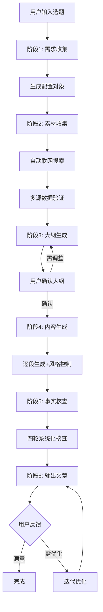

# 远川商业写作大师 - 智能文章自动生成器

## 🎯 核心功能

这是一个**智能文章自动生成系统**,而不仅仅是写作指导工具。

**核心能力**:
- ✅ **自动生成完整文章**: 用户提供选题,系统自动生成8000-10000字完整文章
- ✅ **智能联网搜索**: 自动搜索企业财报、行业报告、深度报道等素材
- ✅ **自动事实核查**: 四轮系统化核查,确保数据准确、逻辑自洽
- ✅ **远川风格保证**: 数据艺术化、节奏控制、金句点睛,完美复刻远川风格
- ✅ **双输出模式**: 支持对话展示和文件保存两种方式

## 🚀 使用方式

用户只需一句话启动:

```
我想写一篇关于[公司名/事件/趋势]的商业分析文章
```

**示例**:
- "我想写一篇关于小米汽车的分析"
- "写一篇关于Temu的商业模式文章"
- "分析一下理想汽车最近的经营策略"

## 📋 适用场景

**应该使用本Skill**:
1. 用户明确要求写作商业分析文章
2. 用户提供商业选题(公司/行业/事件/人物)
3. 用户提到"远川风格"或"商业深度分析"
4. 用户需要完整的文章,而非写作指导

**不应使用本Skill**:
- 用户只是咨询写作技巧(如"怎么写好标题?")
- 用户需要其他类型内容(技术文档、学术论文、短文案)
- 用户已有文章草稿,只需优化建议

---

## 🔧 完整工作流程

### 工作流程图



---

## 📖 详细执行步骤

### 阶段1: 需求收集与配置生成

**加载模块**: `modules/interaction-engine.md`

**执行流程**:

1. **识别选题类型**
   - 自动判断: 公司/行业/事件/人物/商业模式
   - 示例: "小米汽车" → 单一公司

2. **提问1: 生成级别选择**
   ```
   请选择文章生成级别:
   
   a) 基础版 (5000-6000字, 3-4小时完成)
      - 结构完整,逻辑清晰,适合快速解读
      
   b) 进阶版 (8000-10000字, 6-8小时完成) ⭐ 推荐
      - 深度剖析,数据丰富,观点鲜明
      
   c) 专业版 (10000+字, 2-3天完成)
      - 全景式解析,多轮事实核查,接近人工水平
   
   请输入 a/b/c (不输入默认选b):
   ```

3. **提问2-6: 详细需求确认**
   - Q2: 核心关注问题(商业模式/竞争优势/发展历程等)
   - Q3: 素材获取方式(完全自动/用户提供/混合)
   - Q4: 文章类型偏好(财报解读/战略分析/兴衰史等)
   - Q5: 特殊要求(目标读者/文章基调/对比竞品等)
   - Q6: 输出模式(对话展示/文件保存/两者)

4. **生成配置对象**
   ```typescript
   {
     topic: { subject: "小米汽车", type: "company", coreQuestions: ["商业模式", "竞争优势"] },
     generation: { level: "advanced", targetWords: {min: 8000, max: 10000} },
     article: { type: "strategic", tone: "neutral" },
     material: { source: "auto" },
     output: { mode: "both", filename: "小米汽车_战略分析_20250128.md" }
   }
   ```

5. **展示配置预览,等待用户最终确认**

**输出**: 完整的ArticleGenerationConfig对象

---

### 阶段2: 素材自动收集与验证

**加载模块**: `modules/material-collector.md`

**执行流程**:

1. **生成搜索计划**
   - 根据生成级别确定搜索深度
   - 基础版: 基础信息+核心数据
   - 进阶版: 基础信息+核心数据+深度分析
   - 专业版: 全方位搜索,包含行业报告和专家访谈

2. **分层并行搜索**
   
   **Tier 1: 基础信息层**
   ```typescript
   // 使用web_fetch工具
   webFetch("https://www.xiaomiev.com/about", "提取小米汽车成立时间、工厂位置、产品线");
   webFetch("https://www.google.com/search?q=小米汽车+创始人", "提取创始人和高管信息");
   ```
   
   **Tier 2: 核心数据层**
   ```typescript
   webFetch("小米汽车 销量 订单 2024", "提取2024年的销量、订单、交付量数据");
   webFetch("小米集团 2023年年报", "提取小米汽车投入资金、营收规模");
   webFetch("特斯拉 比亚迪 市占率", "提取竞品对比数据");
   ```
   
   **Tier 3: 深度分析层**
   ```typescript
   webFetch("小米汽车 深度报道 site:36kr.com", "提取行业媒体深度分析");
   webFetch("雷军 小米汽车 访谈 演讲", "提取创始人观点和引语");
   webFetch("新能源汽车 行业报告 2023", "提取行业背景和趋势");
   ```

3. **数据提取与结构化**
   - 正则提取所有数值+单位组合
   - AI识别指标名称和时间点
   - 构建结构化素材库(JSON格式)

4. **多源交叉验证**
   - 按指标分组
   - 单一信源标记"待验证"
   - 多源数据检查一致性(<10%差异视为一致)
   - 冲突数据标记并提示用户

5. **信源可信度评级**
   - ⭐⭐⭐⭐⭐: 上市公司财报、政府文件(可信度100%)
   - ⭐⭐⭐⭐: 券商研报、主流媒体、公司公告(可信度90%)
   - ⭐⭐⭐: 行业媒体、专业机构报告(可信度70%)
   - ⭐⭐: 自媒体、社交媒体(可信度50%,仅作参考)

6. **生成素材收集报告**
   ```markdown
   # 素材收集报告
   
   **研究对象**: 小米汽车
   **核心数据**: 27个 (已验证18个, 待验证7个, 冲突2个)
   **深度文章**: 15篇
   **关键引语**: 8条
   
   ⚠️ 需要关注:
   - "小米SU7 BOM成本": 3个信源分别为22万/26万/28万 (差异27%)
     建议: 使用中位数26万,标注"据XX券商测算"
   
   ✅ 素材库已生成: material-db-xiaomi-car-20250128.json
   ```

**输出**: 结构化素材库(MaterialDatabase对象)

---

### 阶段3: 智能大纲生成

**加载模块**: `references/08-framework-generator.md`

**执行流程**:

1. **匹配写作框架**
   - 根据文章类型选择框架模板
   - 财报解读型 → PAC框架(问题-分析-结论)
   - 战略分析型 → 拆解框架(背景-逻辑层1-2-3-结尾)
   - 兴衰史型 → 时间线框架(起-承-转-合)

2. **生成详细大纲**
   ```markdown
   # 文章大纲预览
   
   ## 标题候选 (3个)
   1. 小米汽车亏本卖,雷军到底在下什么棋？ ⭐ 推荐
   2. 21.59万的小米SU7,和1999元的小米手机,是同一个故事
   3. 10万张订单,亏损40亿:小米汽车的"赔本赚吆喝"
   
   ## 一、开篇引子 (300-400字)
   - 手法: 对比反差
   - 核心矛盾: 明明亏钱,为什么还要这么做?
   - 情感基调: 克制但有力
   
   ## 二、背景铺陈 (600-800字)
   - 从手机到汽车的逻辑延续
   - 行业背景: 新能源车渗透率突破40%
   - 引出问题: 亏本卖车的三重逻辑是什么?
   
   ## 三、正文模块1: 第一层逻辑 (1200-1500字)
   - 分论点: 占领用户心智,抢夺换购红利
   - 数据支撑: 3.4亿保有量、40%渗透率、5000万潜在用户
   - 案例: 特斯拉/比亚迪/理想的市场定位
   
   [后续模块...]
   
   **预计完成字数**: 8500字
   **预计完成时间**: 6-8小时
   ```

3. **用户确认大纲**
   - 用户可调整结构、增删模块、修改重点
   - 确认后进入内容生成阶段

**输出**: 详细大纲(Outline对象)

---

### 阶段4: 内容自动生成

**加载模块**: `modules/content-generator.md`

**执行流程**:

1. **非线性生成顺序**
   ```
   步骤1: 生成背景铺陈 (600-800字)
   步骤2: 生成正文模块1-3 (每个1200-1500字)
   步骤3: 生成结尾升华 (400-500字)
   步骤4: 生成开篇钩子 (300-400字)
   步骤5: 生成标题 (3个候选)
   ```
   
   **原理**: 先主体后两端,思路逐渐清晰

2. **逐段生成+风格控制**
   
   每段生成时自动应用:
   
   **特征1: 数据艺术化**
   - ❌ 生硬: "小米2023年营收2710亿元"
   - ✅ 艺术化: "2710亿元,相当于每天赚7.4亿元,每秒赚8500元"
   
   **特征2: 长短句配比7:3**
   - 70%长句(20+字): 用于叙事和论证
   - 30%短句(10-字): 用于强调和转折
   
   **特征3: 紧松节奏4:6**
   - 40%紧段: 密集数据+冲突+快节奏
   - 60%松段: 背景+案例+人物+慢节奏
   
   **特征4: 金句点睛**
   - 每800字1个金句,全文2-4个
   - 类型: 揭示本质/对比/哲理升华/反转

3. **实时进度展示**(对话模式)
   ```
   🚀 开始生成文章...
   
   ✅ [1/5] 背景铺陈 (720字) 已完成
   ✅ [2/5] 正文模块1 (1350字) 已完成
   ⏳ [3/5] 正文模块2 生成中... (预计2分钟)
   
   📊 当前进度: 40%
   📝 已生成字数: 2070 / 8500字
   ```

4. **质量自检**
   - 每段生成后自动检查: 字数、数据密度、句式比例、逻辑连贯性
   - 不合格自动重新生成

**输出**: 完整文章内容(8000-10000字)

---

### 阶段5: 自动事实核查

**加载模块**: `modules/fact-checker.md`

**执行流程**:

1. **第一轮: 数据核查**
   - 提取文章中所有数值
   - 与素材库交叉比对
   - 检查单位、时间点、统计口径

2. **第二轮: 时间线核查**
   - 提取所有时间节点
   - 检查事件先后顺序
   - 验证"之前/之后/同期"等逻辑一致性

3. **第三轮: 实体核查**
   - 提取人名、公司名、产品名
   - 检查拼写和规范性
   - 验证职位准确性

4. **第四轮: 引用核查**
   - 提取所有直接引语和数据引用
   - 检查是否标注来源
   - 生成参考文献列表

5. **综合核查报告**
   ```markdown
   # 事实核查报告
   
   **核查概览**: 81项核查, 75项通过, 6项需修正
   
   ⚠️ 需要修正:
   1. 第3段: "2800亿元" → "2710亿元" (数据错误)
   2. 第5段: "2023年" → "2024年3月28日" (时间错误)
   3. 第6段: 引语缺少来源,建议补充
   
   ✅ 参考文献已生成 (12条)
   
   **核查结论**: 文章事实基础扎实,修正后可发布
   ```

6. **自动修正**
   - 对明确错误自动修正
   - 需人工确认的标记提示

**输出**: 核查报告+修正后的文章+参考文献

---

### 阶段6: 输出与交付

**执行流程**:

1. **对话展示模式**
   ```markdown
   # 小米汽车亏本卖,雷军到底在下什么棋？
   
   [完整文章内容...]
   
   ---
   
   📊 文章统计:
   - 总字数: 8520字
   - 阅读时长: 约11分钟
   - 数据点: 27个 (已验证100%)
   - 参考文献: 12条
   
   💾 是否保存为文件？(y/n)
   ```

2. **文件保存模式**
   ```
   ✅ 文章已保存: 
   📄 小米汽车_战略分析_20250128.md
   
   文件包含:
   - 完整文章正文 (8520字)
   - 参考文献列表 (12条)
   - 数据源清单
   - 事实核查报告
   ```

3. **用户反馈收集**
   ```
   您对这篇文章满意吗？
   
   a) 满意,可以直接使用 ✅
   b) 需要优化某些部分 (请说明)
   c) 重新生成 (调整方向)
   ```

4. **迭代优化**(如需要)
   - 根据用户反馈针对性优化
   - 可调整语言风格、增删内容、补充数据

**最终交付**:
- ✅ 完整文章(.md文件)
- ✅ 参考文献列表
- ✅ 数据源清单
- ✅ 事实核查报告

---

## 📚 核心知识库

本Skill基于以下知识库构建(位于`references/`目录):

1. **00-INDEX.md**: 知识库总览与快速索引
2. **01-writing-methodology.md**: 写作方法论(标题/开篇/正文/结尾)
3. **02-case-library.md**: 案例库(3篇标杆文章拆解)
4. **03-template-library.md**: 模板库(40+个可复用模板)
5. **04-fact-checking-standards.md**: 事实核查标准
6. **05-fact-check-execution-guide.md**: 事实核查执行指南
7. **06-information-search-methodology.md**: 信息搜索方法论
8. **07-style-training-advanced.md**: 文风深度训练手册
9. **08-framework-generator.md**: 框架生成器

**总规模**: 约6万字深度指南

---

## 🎯 核心执行原则

当用户触发本Skill时,按以下原则执行:

### 原则1: 完整流程执行

- ✅ **必须执行完整的6个阶段**,不可跳过任何环节
- ✅ **每个阶段完成后**,向用户展示进度和成果
- ✅ **关键节点**(大纲确认、文章生成完成)需等待用户反馈

### 原则2: 自动化优先

- ✅ **能自动的不问用户**: 素材搜索、数据验证、事实核查全自动
- ✅ **默认值合理**: 每个选项都有最优默认值(如进阶版、中立基调)
- ✅ **渐进式提问**: 必问→推荐→可选,避免信息过载

### 原则3: 质量第一

- ✅ **数据必须准确**: 多源验证,交叉比对,宁可删除也不捏造
- ✅ **风格严格遵循**: 数据艺术化、节奏控制、金句点睛缺一不可
- ✅ **事实核查必须**: 四轮核查完成前不输出最终文章

### 原则4: 用户体验至上

- ✅ **进度可视化**: 实时展示生成进度,让用户知道AI在做什么
- ✅ **允许调整**: 大纲、内容、风格都可根据用户反馈迭代优化
- ✅ **双输出模式**: 既可对话展示,也可保存文件

---

## ⚠️ 关键注意事项

### 1. 信源问题

**如果搜索到的信息不足或冲突严重**:

```
⚠️ 素材收集遇到问题:

关于"${subject}"的公开信息较少/存在较大冲突。

建议:
a) 您提供核心素材(如财报、内部资料),我来补充背景
b) 调整选题为更知名的公司/事件
c) 降低生成级别为"基础版"(减少数据需求)

请选择: 
```

### 2. 敏感信息处理

**如果涉及负面、争议、未证实的内容**:

- ✅ 必须有权威媒体报道(⭐⭐⭐⭐以上)
- ✅ 必须标注"据XX报道",不做主观判断
- ✅ 必须有官方回应或法律文书支撑
- ❌ 不使用"知情人士"、"有消息称"等模糊信源
- ❌ 不传播未经证实的传言

### 3. 字数控制

- ✅ **最低5000字**,不得低于此标准
- ✅ **通常8000-10000字**,符合远川文章平均长度
- ✅ **根据复杂度调整**: 简单选题6000字,复杂选题10000字

### 4. 风格一致性

**全文必须保持统一**:

- ✅ 数据密度: 每300字1-2个关键数据
- ✅ 长短句比: 7:3(长句70%,短句30%)
- ✅ 紧松节奏: 4:6(紧段40%,松段60%)
- ✅ 金句数量: 2-4个,独立成段或段尾

---

## 💡 使用示例

### 示例1: 完整流程演示

```
👤 我想写一篇关于小米汽车的商业分析文章

🤖 [启动远川商业写作大师Skill]

【阶段1: 需求收集】

您想研究的对象是: 小米汽车

✅ 已自动识别:
- 类型: 单一公司
- 行业: 新能源汽车
- 时间范围: 2024年发布至今

请选择文章生成级别:
a) 基础版 (5000-6000字, 3-4小时)
b) 进阶版 (8000-10000字, 6-8小时) ⭐ 推荐
c) 专业版 (10000+字, 2-3天)

请输入 a/b/c (不输入默认选b):

👤 b

🤖 您最关心什么问题?(可多选)
a) 商业模式是什么?为什么能赚钱?
b) 竞争优势在哪里?
c) 发展历程中的关键转折点
d) 当前面临的困境和挑战
e) 未来发展趋势和机会

请选择1-3个(输入字母,如"a,b"):

👤 a,b

🤖 [继续问题2-6...]

【阶段2: 素材收集】

🔍 开始自动搜索素材...

✅ [1/3] 基础信息收集完成 (30秒)
✅ [2/3] 核心数据收集完成 (2分钟)
⏳ [3/3] 深度分析收集中... (预计3分钟)

✅ 素材收集完成!

📊 收集概览:
- 核心数据: 27个 (已验证18个, 待验证7个, 冲突2个)
- 深度文章: 15篇
- 关键引语: 8条

⚠️ 需要关注: "小米SU7 BOM成本"存在数据冲突...
(详细报告已生成)

【阶段3: 大纲生成】

📋 已生成详细大纲 (预览):

标题候选:
1. 小米汽车亏本卖,雷军到底在下什么棋? ⭐ 推荐
2. 21.59万的小米SU7,和1999元的小米手机,是同一个故事
3. ...

[完整大纲结构...]

预计字数: 8500字
预计时间: 6-8小时

是否确认大纲?(y/n/调整)

👤 y

【阶段4: 内容生成】

🚀 开始生成文章...

✅ [1/5] 背景铺陈 (720字) 已完成
✅ [2/5] 正文模块1 (1350字) 已完成
✅ [3/5] 正文模块2 (1280字) 已完成
⏳ [4/5] 正文模块3 生成中... (预计2分钟)

【阶段5: 事实核查】

🔍 开始四轮核查...

✅ 第一轮: 数据核查 (23个数据点, 2个需修正)
✅ 第二轮: 时间线核查 (15个时间点, 1个需修正)
✅ 第三轮: 实体核查 (20个实体, 全部通过)
✅ 第四轮: 引用核查 (23处引用, 2处需补充来源)

🔧 自动修正完成 (3处)
⚠️ 2处需人工确认...

📚 参考文献已生成 (12条)

【阶段6: 输出文章】

✅ 文章生成完成!

📊 文章统计:
- 总字数: 8520字
- 阅读时长: 约11分钟
- 数据点: 27个 (已验证100%)
- 参考文献: 12条

[完整文章内容展示...]

💾 是否保存为文件?(y/n)

👤 y

🤖 ✅ 已保存: 小米汽车_战略分析_20250128.md

您对这篇文章满意吗?
a) 满意,可以直接使用
b) 需要优化某些部分
c) 重新生成

👤 a

🤖 ✅ 完成! 祝您创作愉快! 🎉
```

---

## 🔗 相关资源

### 知识库目录

```
.codebuddy/skills/yuanchuan-business-writer/
├── SKILL.md (本文件)
├── README.md (使用指南)
├── EXAMPLES.md (详细示例)
├── references/ (知识库)
│   ├── 00-INDEX.md
│   ├── 01-writing-methodology.md
│   ├── 02-case-library.md
│   ├── 03-template-library.md
│   ├── 04-fact-checking-standards.md
│   ├── 05-fact-check-execution-guide.md
│   ├── 06-information-search-methodology.md
│   ├── 07-style-training-advanced.md
│   └── 08-framework-generator.md
└── modules/ (执行模块)
    ├── interaction-engine.md
    ├── material-collector.md
    ├── content-generator.md
    └── fact-checker.md
```

### 快速参考

- **标题公式**: 见`references/01-writing-methodology.md`第1节
- **开篇手法**: 见`references/07-style-training-advanced.md`第2节
- **数据呈现**: 见`references/07-style-training-advanced.md`第4节
- **金句提炼**: 见`references/07-style-training-advanced.md`第5节
- **事实核查**: 见`references/04-fact-checking-standards.md`

---

## 🚀 立即开始

当用户输入以下任一触发词时,立即启动本Skill:

✅ "我想写一篇关于XX的商业分析文章"
✅ "写一篇XX的深度分析"
✅ "帮我分析一下XX公司"
✅ "生成一篇关于XX的文章"

**不要等待**,直接进入阶段1的第一个问题,开始收集需求!

---

**版本**: v2.0 (智能文章自动生成器)
**更新日期**: 2025-01-28
**核心能力**: 需求收集 → 自动搜索 → 智能生成 → 事实核查 → 完整交付

When this skill is invoked, follow this structured workflow:

### Stage 1: Topic Assessment & Framework Generation (30 minutes)

**Objective**: Evaluate topic feasibility and generate detailed outline

**Steps**:

1. **Collect topic information** using the interactive questionnaire from `references/08-framework-generator.md` Section II:
   - Research subject (company/event name)
   - Industry category
   - Writing motivation and core question
   - Time scope
   - Expected output (word count, deadline)

2. **Assess feasibility** across three dimensions:
   - Information richness (⭐⭐⭐⭐⭐ rating)
   - Timeliness (High/Medium/Low)
   - Controversy/topicality (High/Medium/Low)
   - **Recommendation**: Only proceed if information richness ≥ ⭐⭐⭐

3. **Determine article type** and match appropriate framework:
   - Financial report analysis → PAC Framework (Problem-Analysis-Case)
   - Strategic analysis → PAC Framework
   - Company rise/fall → Timeline Framework
   - Industry trends → Comparison Framework
   - Business model → Deconstruction Framework
   - Event review → Timeline Framework

4. **Generate detailed outline** using templates from `references/08-framework-generator.md` Section IV:
   - Provide 3 candidate titles (judgmental/question/data-shock styles)
   - Break down each section with:
     - Word count allocation
     - Core arguments
     - Required data points
     - Writing guidance
   - Include data collection checklist
   - Provide time management plan

**Output**: Present the complete outline to user for confirmation before proceeding.

---

### Stage 2: Information Research & Material Collection (4-8 hours)

**Objective**: Systematically collect verified materials following information search methodology

**Follow the structured research paths in `references/06-information-search-methodology.md`**:

1. **Basic company information** (2-3 hours):
   - Business registration (天眼查/企查查)
   - Financial reports (if listed company)
   - Founder/executive backgrounds
   - Company timeline

2. **Core data collection**:
   - Financial metrics (revenue, profit, growth rates)
   - Market data (market share, industry size)
   - Operational data (users, GMV, stores)
   - **Critical**: Note data source, time point, and statistical methodology for each data point

3. **Deep research materials** (2-3 hours):
   - Industry reports (券商研报/艾瑞/IDC)
   - In-depth media coverage (晚点LatePost/36氪/财新)
   - Founder interviews and speeches
   - Competitor analysis

4. **Organize materials** using the Excel template from Section VI:
   - Categorize by article section
   - Rate source credibility (⭐⭐⭐⭐⭐ to ⭐☆☆☆☆)
   - Tag priority (High/Medium/Low)
   - Track completion status

**Source credibility standards** (from `references/04-fact-checking-standards.md`):
- **Tier 1 (⭐⭐⭐⭐⭐)**: Financial reports, government documents, court judgments, authoritative media
- **Tier 2 (⭐⭐⭐⭐☆)**: Research reports, mainstream media, company official announcements
- **Tier 3 (⭐⭐⭐☆☆)**: Self-media, social media (requires verification)
- **Prohibited sources**: Anonymous tips, hearsay without evidence

**Output**: Inform user when material collection is complete and ready for drafting.

---

### Stage 3: Drafting (6-10 hours across 2 days)

**Objective**: Write the article following Yuanchuan style guidelines

**Apply writing methodology from `references/01-writing-methodology.md` and `references/07-style-training-advanced.md`**:

#### Day 1: Main Body Writing

**Recommended sequence** (write body first, opening last):

1. **Background section** (500-800 characters) - Easiest to start:
   - Company basic info (1-2 sentences)
   - Industry context with timeline (3-5 key dates)
   - Current competitive landscape
   - Transition to core question

2. **Main body modules** (800-1200 characters each):
   - **Structure**: Argument → Data → Case → Summary
   - **Data presentation**: Use 12 visualization methods from references
     - Time visualization: "相当于每天赚8.2亿"
     - Space visualization: "相当于1400个足球场"
     - Comparison: "市值蒸发相当于4个拼多多"
     - Per capita: "人均创造营收1.35亿"
   - **Rhythm control**: 7:3 ratio of long sentences (20+ characters) to short sentences (10- characters)
   - **Paragraph layers**: Mix of long (200-400 char), medium (100-200 char), short (50-100 char)

3. **Tight-loose transitions**: Alternate between dense information and breathing room
   - "Tight" sections (40%): Core conflicts, data clusters, dramatic developments
   - "Loose" sections (60%): Background, case studies, character portraits, reflections

#### Day 2: Opening and Closing

4. **Opening hook** (300-400 characters) - Write last when thinking is clearest:
   
   Choose from three approaches (detailed in `references/07-style-training-advanced.md` Section II):
   
   **A. Dramatic scene opening** (戏剧化场景):
   ```
   Formula: [Specific time + location] + [Key person + action] + [Core conflict] + [Suspense/countdown]
   
   Example: "2023年3月的一个深夜,京东总部的会议室里,刘强东在白板上写下一个数字:100亿。
   '要用百亿补贴抢回失去的用户',他转身对团队说..."
   ```
   
   **B. Contrast opening** (对比反差):
   ```
   Formula: [Time], [Subject achieved A + data], but [Transition], [Negative phenomenon B + data], 
   [One-sentence summary of contradiction]
   
   Example: "2023年,小米营收2709亿,重回全球手机前三;但扣除投资收益后,经营利润同比暴跌67%,
   十年来最惨烈的一次。这是小米最分裂的一年:表面风光,内里焦虑。"
   ```
   
   **C. Data shock opening** (数据震撼):
   ```
   Formula: [Time period], [Shocking number], equivalent to [Visualization/analogy], 
   [Phenomenon behind data], [Elevated meaning]
   
   Example: "48小时,3000亿。相当于每秒钟烧掉173万,每分钟烧掉1.04亿,
   比2008年美国金融危机时联储的印钞速度还快..."
   ```

5. **Closing elevation** (300-500 characters):
   - Echo the theme (without simple repetition)
   - Philosophical insight (from specific case to universal principle)
   - Leave resonance (suspense/outlook/rhetorical question)
   - **Golden phrases** (2-4 per article maximum):
     - "技术的尽头是组织,组织的尽头是文化"
     - "这不是一家公司的胜利,而是一个时代的选择"

**Writing quality standards**:
- ✅ Long-short sentence ratio: 7:3 golden ratio
- ✅ Data frequency: Maximum 2-3 key numbers per paragraph
- ✅ All data must have comparison (YoY/QoQ/competitor)
- ✅ Golden phrases: 2-4 per article, strategically placed
- ❌ Avoid excessive emotionalism ("令人震惊"、"让人落泪")
- ❌ Avoid jargon overload (explain ARPU, ROI in plain language)
- ❌ Avoid simple labeling (analyze complexity, not just "success/failure")

**Reference materials for drafting**:
- `references/01-writing-methodology.md` - Title formulas, opening techniques, data presentation
- `references/07-style-training-advanced.md` - Deep style training, rhythm control, golden phrases
- `references/02-case-library.md` - Benchmark article analysis
- `references/03-template-library.md` - Quick-start templates

---

### Stage 4: Fact-Checking (3-4 hours)

**Objective**: Ensure 100% factual accuracy through systematic verification

**Execute the four-round verification method from `references/05-fact-check-execution-guide.md`**:

#### Round 1: Data Verification
- Search all numbers in the article
- Verify each against original source
- Check unit consistency (亿/万亿/美元/人民币)
- Cross-reference conflicting data from multiple sources

#### Round 2: Timeline Verification
- Extract all time references
- Confirm "YYYY年"、"Q1-Q4"、"上半年" accuracy
- Check for logical contradictions in chronology

#### Round 3: Names & Entities
- Verify all person names (no typos)
- Confirm titles/positions accurate (note time context)
- Standardize company full names/abbreviations

#### Round 4: Citation Sourcing
- Add source attribution for all quotes and data
- Generate bibliography in standard format
- Remove any claims lacking traceable sources

**Special handling** (from `references/05-fact-check-execution-guide.md` Section IV):

- **Negative information**: Must cite court documents or official statements
- **Controversial viewpoints**: Present multiple perspectives, label as "有观点认为"
- **Predictions**: Clearly mark as forecasts, note source and assumptions

**Fact-checking "Three Never Principles"**:
- ❌ Never fabricate: No invented or speculated data
- ❌ Never exaggerate: Don't turn "possible" into "definite"
- ❌ Never mislead: No cherry-picking or hiding unfavorable data

**Output**: Present fact-checking report with:
- Verified facts (with sources)
- Items requiring correction
- Unverifiable content (recommend deletion)
- Complete bibliography

---

### Stage 5: Polishing & Final Review (2-3 hours)

**Objective**: Refine language and ensure quality standards

**Apply the comprehensive checklist from `references/08-framework-generator.md` Section VIII**:

#### Structure Check
- ✅ Opening hook engaging? (Dramatic/contrast/data shock)
- ✅ Background clear for unfamiliar readers?
- ✅ Main body logic coherent? (Argument-evidence-conclusion)
- ✅ Closing elevated? (Not simple summary)

#### Content Check
- ✅ Core data accurate? (Cross-verified)
- ✅ All quotes sourced? (Traceable to original)
- ✅ Cases sufficient? (Every argument supported)
- ✅ Viewpoints objective? (Avoid excessive subjectivity)

#### Language Check
- ✅ Long-short sentence ratio appropriate? (7:3 golden ratio)
- ✅ Paragraph length layered? (Long-medium-short mix)
- ✅ Data presentation artistic? (Visualized, compared, analogized)
- ✅ Golden phrases appropriate? (2-4, not overused)

#### Fact Check
- ✅ All data sourced
- ✅ All time points verified
- ✅ All names/company names typo-free
- ✅ Controversial content labeled "有观点认为"

**Final output**: Present the polished article with:
- Main text (formatted in markdown)
- Complete bibliography
- Data source list
- Word count and reading time estimate

---

## Progressive Disclosure Strategy

To manage context efficiently, load references progressively based on current workflow stage:

**Always in context** (Metadata): Skill description and workflow overview

**Stage 1 (Topic Assessment)**:
- Load: `references/08-framework-generator.md` (Sections I-III)
- Output: Detailed outline for user confirmation

**Stage 2 (Research)**:
- Load: `references/06-information-search-methodology.md` (Sections I-V)
- Load: `references/04-fact-checking-standards.md` (信源分级)
- Guide: Real-time research path recommendations

**Stage 3 (Drafting)**:
- Load: `references/01-writing-methodology.md` (标题/开篇/数据/金句)
- Load: `references/07-style-training-advanced.md` (风格训练)
- As needed: `references/02-case-library.md` (specific examples)
- As needed: `references/03-template-library.md` (templates)

**Stage 4 (Fact-Checking)**:
- Load: `references/05-fact-check-execution-guide.md` (四轮核查)
- Load: `references/04-fact-checking-standards.md` (完整标准)

**Stage 5 (Polishing)**:
- Review: Quality checklist from `references/08-framework-generator.md`

## Interaction Guidelines

**Communication style**:
- Use Chinese (Simplified) for all interactions
- Be concise and actionable
- Ask clarifying questions when topic information is incomplete
- Provide specific, implementable suggestions (not vague advice)

**User confirmation points**:
1. After generating outline (before research)
2. After material collection (before drafting)
3. After fact-checking (before finalizing)
4. When encountering controversial content

**Handling edge cases**:
- **Insufficient materials**: Suggest alternative sources or narrow topic scope
- **Conflicting data**: Present multiple sources, recommend prioritizing Tier 1 sources
- **Tight deadline**: Recommend fast 3000-character template from `references/03-template-library.md`
- **Controversial topic**: Strictly follow `references/05-fact-check-execution-guide.md` Section IV guidelines

## Success Criteria

A successfully completed article should achieve:

✅ **Content quality**:
- Clear argument with logical structure
- Every claim supported by verified data
- Rich cases and vivid storytelling
- Philosophical insights elevating specific cases

✅ **Style adherence**:
- Opening hook captures attention immediately
- Rhythm alternates between tight and loose sections
- Data presented artistically (visualized, not raw numbers)
- 2-4 golden phrases strategically placed
- Restrained yet warm tone throughout

✅ **Factual accuracy**:
- 100% data verified with sources
- Complete bibliography in standard format
- No unverifiable claims
- Controversial content handled appropriately

✅ **Readability**:
- Accessible to non-expert readers
- Engaging narrative flow
- Professional but not jargon-heavy
- 3000-8000 characters appropriate for WeChat reading

## Examples of Skill Usage

**Example 1: Financial report analysis**

```
User: "帮我写一篇小米2023年财报分析文章"