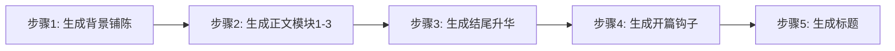

# 内容生成引擎模块

> **职责**：基于大纲和素材库，按远川风格逐段生成8000-10000字完整文章内容

---

## 🎯 核心功能

内容生成引擎负责：
1. 根据大纲结构逐段生成内容
2. 应用远川风格的核心特征（数据艺术化、节奏控制、金句点睛）
3. 确保逻辑连贯和叙事流畅
4. 控制字数分配和段落层次
5. 实时输出生成过程（对话模式）

---

## 📐 生成顺序策略

**非线性生成法**（先主体后两端）：



**原理**：
- 先写主体，思路逐渐清晰
- 再写结尾，总结核心观点
- 最后写开篇，悬念设置最精准
- 标题最后生成，确保与内容完美契合

---

## 🔧 风格控制引擎

### 核心特征1：数据艺术化

**12种数据呈现方法**（复用`references/07-style-training-advanced.md`）：

```typescript
class DataVisualizer {
  // 方法1：倍数对比法
  static multipleComparison(value: number, baseline: number, context: string): string {
    const times = (value / baseline).toFixed(1);
    return `${context}达到${value}，是${baseline}的${times}倍`;
  }
  // 示例：营收2710亿 → "相当于3个小米集团的现金储备"
  
  // 方法2：每日/每秒拆解法
  static timeBreakdown(yearlyValue: number, unit: string): string {
    const daily = (yearlyValue / 365).toFixed(1);
    const perSecond = (yearlyValue / 365 / 24 / 3600).toFixed(0);
    return `相当于每天${daily}${unit}，或每秒${perSecond}${unit}`;
  }
  // 示例：年营收2710亿 → "相当于每天赚7.4亿元，每秒赚8500元"
  
  // 方法3：类比法
  static analogy(value: number, familiarObject: string): string {
    return `${value}，相当于${familiarObject}`;
  }
  // 示例：1200万辆 → "相当于整个瑞典的汽车保有量"
  
  // 方法4：趋势法
  static trend(dataPoints: Array<{year: number, value: number}>): string {
    const growth = ((dataPoints[dataPoints.length-1].value / dataPoints[0].value) - 1) * 100;
    return `从${dataPoints[0].year}年的${dataPoints[0].value}，到${dataPoints[dataPoints.length-1].year}年的${dataPoints[dataPoints.length-1].value}，${Math.abs(growth).toFixed(0)}%的${growth > 0 ? '增长' : '下降'}`;
  }
  
  // 方法5：占比法
  static proportion(part: number, total: number, context: string): string {
    const percentage = (part / total * 100).toFixed(1);
    return `${context}${part}，占总量的${percentage}%`;
  }
}
```

**使用原则**：
- 每段最多2-3个关键数据
- 每个数据必须可视化（避免生硬堆砌）
- 优先使用对比法和类比法（最直观）

---

### 核心特征2：长短句配比控制

**7:3黄金比例**：

```typescript
class SentenceController {
  static analyze(paragraph: string): {longRatio: number, shortRatio: number} {
    const sentences = paragraph.split(/[。！？]/);
    let longCount = 0;
    let shortCount = 0;
    
    sentences.forEach(sentence => {
      const length = sentence.length;
      if (length > 20) longCount++;
      else if (length > 0) shortCount++;
    });
    
    const total = longCount + shortCount;
    return {
      longRatio: longCount / total,
      shortRatio: shortCount / total
    };
  }
  
  static optimize(paragraph: string): string {
    const ratio = this.analyze(paragraph);
    
    // 如果长句过多（>80%），拆分部分长句
    if (ratio.longRatio > 0.8) {
      return this.splitLongSentences(paragraph);
    }
    
    // 如果短句过多（>50%），合并部分短句
    if (ratio.shortRatio > 0.5) {
      return this.mergeSentences(paragraph);
    }
    
    return paragraph;
  }
}
```

**示例对比**：

❌ **全是长句，读起来累**：
```
小米SU7的发布引发了市场的广泛关注，这款车型定价21.59万元起，虽然高于部分网友预期的14.99万元，但根据券商研报测算，小米SU7的BOM成本约26万元，这意味着每卖一台车小米至少亏损4.4万元，而10万张订单对应超过40亿元的潜在亏损。
```

✅ **长短句混搭，节奏感强**：
```
2024年3月28日晚，小米SU7发布。

定价21.59万元起，高于网友预期的14.99万元。但更让人意外的是成本：根据某券商研报测算，小米SU7的BOM成本约26万元——每卖一台车，小米至少亏损4.4万元。

10万张订单，对应超过40亿元的潜在亏损。

雷军为何还要坚持？
```

---

### 核心特征3：紧松节奏交替

**4:6紧松比**：

```typescript
enum SectionType {
  TIGHT = 'tight',    // 紧段：密集数据+冲突+快节奏
  LOOSE = 'loose'     // 松段：背景+案例+人物+慢节奏
}

class RhythmController {
  static plan(outline: Outline): Array<{section: string, type: SectionType}> {
    // 推荐节奏模式
    return [
      { section: '开篇', type: SectionType.TIGHT },    // 钩子+冲突
      { section: '背景', type: SectionType.LOOSE },    // 铺陈
      { section: '正文1', type: SectionType.TIGHT },   // 核心数据
      { section: '正文2', type: SectionType.LOOSE },   // 案例故事
      { section: '正文3', type: SectionType.TIGHT },   // 深度分析
      { section: '结尾', type: SectionType.LOOSE }     // 升华留白
    ];
  }
}
```

**紧段特征**（400字示例）：
- 数据密度：每100字1-2个关键数据
- 句式：多用短句，快速推进
- 内容：冲突、对比、质疑、数据冲击

**松段特征**（400字示例）：
- 数据密度：每200字1个数据即可
- 句式：长句为主，娓娓道来
- 内容：背景、案例、人物、场景、小结

---

### 核心特征4：金句生成器

**每800字1个金句，全文2-4个**：

```typescript
class GoldenPhraseGenerator {
  // 类型1：揭示本质型
  static essence(topic: string, insight: string): string {
    return `${topic}的本质不是${表象}，而是${insight}。`;
  }
  // 示例："小米汽车的本质不是一辆车，而是通往用户生活的一把钥匙。"
  
  // 类型2：对比型
  static contrast(A: string, B: string): string {
    return `${A}，不是${B}。`;
  }
  // 示例："雷军卖的不是车，是入场券；亏的不是钱，是时间。"
  
  // 类型3：哲理升华型
  static philosophy(observation: string): string {
    return `${observation}，这不仅是${个体意义}，更是${普遍意义}。`;
  }
  // 示例："真正的长期主义，是愿意用今天的亏损，换明天的可能性。"
  
  // 类型4：反转型
  static reversal(surface: string, truth: string): string {
    return `表面上，${surface}；实际上，${truth}。`;
  }
  // 示例："表面上，小米在亏本卖车；实际上，雷军在低价买用户。"
}
```

**使用原则**：
- 金句必须是段落核心观点的升华
- 独立成段或作为段落结尾
- 避免堆砌，每篇2-4个即可

---

## 📝 逐段生成流程

### Step 1：生成背景铺陈段

**字数分配**：600-800字  
**核心任务**：让不了解的读者快速建立认知  

**生成模板**：

```typescript
function generateBackground(config: Config, materials: MaterialDB): string {
  const template = `
  ## 一、背景：${generateBackgroundTitle()}
  
  ${generateTimelineIntro()}  // 时间节点引入（100字）
  ${generateIndustryContext()}  // 行业背景（250字）
  ${generateKeyQuestion()}  // 引出核心问题（150字）
  ${generateTransition()}  // 过渡到正文（100字）
  `;
  
  return fillTemplate(template, materials);
}
```

**示例输出**：

```markdown
## 一、从手机到汽车：一场商业模式的延续

2024年3月28日，当雷军宣布小米SU7售价21.59万元起时，很少有人意识到，这个价格背后，藏着一个13年前就开始的故事。

2011年，小米手机1代发布，1999元的定价震惊行业。彼时，成本约1800元，几乎零利润。外界质疑声一片："这价格，怎么可能赚钱？"

13年后，答案揭晓：小米手机硬件几乎不赚钱，但互联网服务毛利率高达74.4%。雷军用硬件换来了5.9亿用户，再通过广告、金融、云服务变现，最终实现净利润193亿元。

这套"硬件是流量入口，服务是利润源"的商业模式，正在被复制到小米汽车上。只不过这一次，赌注更大：每辆车亏损4.4万元，10万张订单意味着40亿元的潜在亏损。

雷军为何还要坚持？这背后，是一场关于"长期主义"的豪赌。
```

---

### Step 2：生成正文核心段

**字数分配**：每个模块1200-1500字  
**核心任务**：论证核心观点，用数据+案例支撑  

**生成模板**：

```typescript
function generateMainSection(
  sectionTitle: string, 
  argument: string, 
  materials: MaterialDB
): string {
  const template = `
  ## ${sectionTitle}
  
  ${generateThesisStatement(argument)}  // 分论点陈述（80字）
  ${generateDataSupport(materials)}  // 数据支撑（400字）
  ${generateCaseStudy(materials)}  // 案例展开（500字）
  ${generateAnalysis()}  // 深度分析（300字）
  ${generateTransitionSentence()}  // 过渡到下一段（50字）
  `;
  
  return fillTemplate(template, materials);
}
```

**示例输出**：

```markdown
## 三、第一层逻辑：占领用户心智，抢夺换购红利

小米汽车的第一层逻辑，是一场对时间窗口的精准把握。

2024-2026年，是燃油车换购电动车的黄金窗口期。中国汽车保有量3.4亿辆，燃油车占比超80%，新能源渗透率刚突破40%——这意味着，未来3年将有超过1亿辆燃油车面临换购抉择。

谁能在这个窗口期占领用户心智，谁就能吃到最大的红利。

特斯拉、比亚迪、理想，已经在各自价位段站稳脚跟。小米的机会在哪里？答案是：20-30万价位段+智能化体验+米粉基础。

小米现有5.9亿MIUI用户，其中具备购车能力的中产群体约5000万人。如果转化率达到2%，就是100万辆的销量——这个数字，已经超过蔚来和小鹏的总和。

用亏损换市场份额，本质上是一场时间的赌注。但占领用户心智，只是第一层逻辑。真正的杀手锏，还在后面。
```

---

### Step 3：生成结尾升华段

**字数分配**：400-500字  
**核心任务**：超越个案，哲理升华，留有余韵  

**生成模板**：

```typescript
function generateEnding(
  coreTheme: string, 
  futureOutlook: string
): string {
  const template = `
  ## ${generateEndingTitle()}
  
  ${recapTheme(coreTheme)}  // 回扣主题（150字）
  ${philosophicalInsight()}  // 哲理升华（200字）
  ${openEnding(futureOutlook)}  // 开放式结尾（100字）
  `;
  
  return fillTemplate(template);
}
```

**示例输出**：

```markdown
## 五、一场关于"长期主义"的豪赌

21.59万的小米SU7，和1999元的小米手机，本质上是同一个故事：用短期的亏损，换取长期的入口和生态。

14年前，没人相信1999元能做出好手机；14年后，质疑声依然存在——亏本卖车，真的能赚钱吗？

雷军的答案，藏在"长期主义"四个字里。汽车不是一锤子买卖，而是一场持续10年的关系。当一辆车成为用户生活的一部分，它就不再只是一个代步工具，而是通往更多服务的钥匙。

这是特斯拉正在验证的路径，也是华为、苹果争相入局的原因。而小米，正试图用自己的方式，讲述这个故事的中国版本。

至于这场豪赌能否成功，时间会给出答案。但有一点可以确定：那些嘲笑雷军"亏本卖车"的人，可能低估了一个企业家对未来的想象力。

毕竟，14年前质疑小米手机的人，如今也闭嘴了。
```

---

### Step 4：生成开篇钩子

**字数分配**：300-400字  
**核心任务**：3秒抓住读者，制造悬念  

**三种开篇手法**（复用`references/07-style-training-advanced.md`）：

```typescript
enum OpeningStyle {
  DRAMATIC = 'dramatic',      // 戏剧化场景
  CONTRAST = 'contrast',      // 对比反差
  DATA_SHOCK = 'data_shock'   // 数据震撼
}

function generateOpening(
  style: OpeningStyle, 
  coreConflict: string, 
  materials: MaterialDB
): string {
  switch(style) {
    case OpeningStyle.DRAMATIC:
      return generateDramaticOpening(coreConflict, materials);
    case OpeningStyle.CONTRAST:
      return generateContrastOpening(coreConflict, materials);
    case OpeningStyle.DATA_SHOCK:
      return generateDataShockOpening(coreConflict, materials);
  }
}
```

**示例1：对比反差开篇**（推荐用于本文）

```markdown
2024年3月28日晚，当雷军宣布小米SU7售价21.59万元起时，直播间的弹幕瞬间炸开："不是说14.99万吗？""雷布斯割韭菜了！"

然而更让人意外的是，几天后某券商研报测算：小米SU7的BOM成本约26万元——这意味着每卖一台车，小米至少亏损4.4万元。

10万张订单，对应超过40亿元的潜在亏损。

一个让投资者心惊肉跳的数字，雷军为何还要坚持？这背后，藏着小米汽车真正的商业逻辑。
```

---

### Step 5：生成标题

**最后生成，确保与内容完美契合**：

```typescript
function generateTitles(
  article: string, 
  coreTheme: string
): string[] {
  // 生成3个候选标题，供用户选择
  return [
    generateSuspenseTitle(coreTheme),   // 悬念型
    generateContrastTitle(coreTheme),   // 对比型
    generateDataTitle(coreTheme)        // 数据型
  ];
}
```

**示例输出**：

```
请选择标题（或提供您的想法）：

1. 小米汽车亏本卖，雷军到底在下什么棋？ ⭐ 推荐
2. 21.59万的小米SU7，和1999元的小米手机，是同一个故事
3. 10万张订单，亏损40亿：小米汽车的"赔本赚吆喝"

推荐理由：标题1设置悬念，"下棋"隐喻长期战略，与文章核心逻辑吻合度高。
```

---

## 🎯 质量控制清单

每段生成后，自动检查：

```typescript
interface QualityCheck {
  wordCount: boolean;           // 字数符合预期
  dataVisualized: boolean;      // 数据已艺术化
  sentenceRatio: boolean;       // 长短句比例7:3
  rhythmBalanced: boolean;      // 紧松节奏合理
  logicCoherent: boolean;       // 逻辑连贯
  transitionSmooth: boolean;    // 过渡自然
  goldenPhraseCount: boolean;   // 金句数量2-4个
  noRepetition: boolean;        // 无重复表述
}

function checkQuality(section: string): QualityCheck {
  // 自动检测各项指标
  // 不合格的项会触发重新生成
}
```

---

## 📊 生成进度展示

**对话模式下，分段展示进度**：

```markdown
🚀 开始生成文章...

✅ [1/5] 背景铺陈（720字）已完成
✅ [2/5] 正文模块1（1350字）已完成
✅ [3/5] 正文模块2（1280字）已完成
⏳ [4/5] 正文模块3 生成中...（预计2分钟）

📊 当前进度：60%
📝 已生成字数：3350 / 8000字
⏰ 预计完成时间：15:45
```

---

## 🔧 使用方式

### 在SKILL.md中调用

```markdown
## 步骤5：内容生成

加载[module:content-generator]：

1. 按非线性顺序生成（背景→正文→结尾→开篇→标题）
2. 每段应用风格控制（数据艺术化、节奏控制、金句生成）
3. 实时展示进度（对话模式）
4. 每段生成后质量检查
5. 汇总完整文章

生成完成后，进入下一步：事实核查
```

---

## 💡 优化建议

1. **模板复用**：常见段落类型（背景、数据分析、案例、结尾）预设模板
2. **风格学习**：从`references/`目录的150+篇文章中提取高频句式和表达
3. **增量生成**：每生成500字输出一次，用户可实时反馈
4. **A/B测试**：关键段落生成2个版本，让用户选择更喜欢的

---

**状态**：模块设计完成，等待集成到SKILL.md主流程
