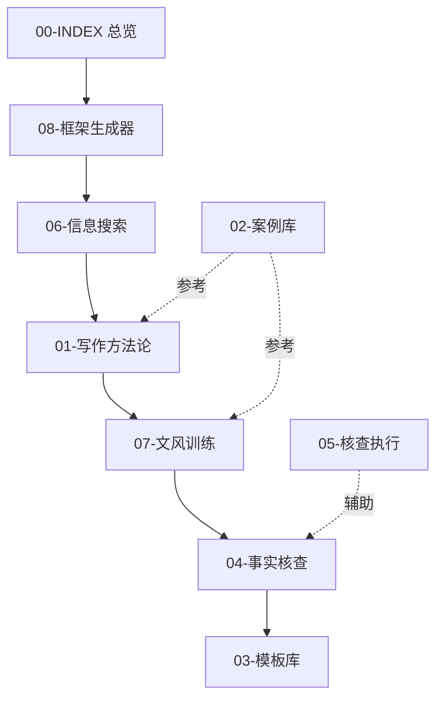

# 远川商业写作知识库总览

## 📚 知识库结构

本知识库是为资深写作者打造的**远川研究所/饭统戴老板风格**商业深度分析写作系统,涵盖从选题到成稿的全流程指导。

### 核心模块(按使用顺序)

## 📖 模块详解

### 🎯 [00-INDEX.md](00-INDEX.md) - 知识库总览
**作用**: 导航和快速查找
**内容**: 
- 知识库结构图
- 各模块简介和使用场景
- 快速查询索引

---

### 🚀 [08-框架生成器](08-framework-generator.md) **[最重要,建议从这里开始]**
**作用**: 从选题到详细大纲的全流程自动化
**内容**:
- 选题可行性评估(3维度打分)
- 信息收集路径图定制
- 文章大纲自动生成(标准5000字/快速3000字)
- 写作时间规划
- 素材管理模板

**使用场景**: 
- ✅ 每次新文章开始前必用
- ✅ 不知道怎么搭建框架时
- ✅ 素材收集没有头绪时

**核心产出**:
- 详细写作大纲(到段落级别)
- 素材收集清单(Excel模板)
- 写作时间规划表
- 质量检查清单

---

### 🔍 [06-信息搜索方法论](06-information-search-methodology.md)
**作用**: 高效、准确地收集素材
**内容**:
- 企业基础信息收集(工商/财报/人物背景)
- 行业背景研究框架(发展史/竞争格局/产业链)
- 关键事件研究(时间线构建/危机深挖)
- 数据可视化来源和方法
- 素材管理系统(文件夹结构+Excel模板)
- 高级搜索技巧和资源推荐

**使用场景**:
- ✅ 开始素材收集时
- ✅ 不知道去哪里找数据时
- ✅ 信息碎片化,需要体系化整理时

**核心工具**:
- 企业研究路径图
- 信息分级清单(一级/二级/三级信源)
- 素材管理Excel模板
- 搜索资源速查表

---

### 📝 [01-写作方法论核心知识库](01-writing-methodology.md)
**作用**: 掌握远川风格的核心写作技巧
**内容**:
- 标题公式库(20+种类型)
- 开篇手法(戏剧化/对比/数据震撼)
- 叙事节奏掌控(长短句/段落层次/紧松转换)
- 数据艺术化呈现(12种方法)
- 金句提炼与使用
- 常用修辞手法和句式模板

**使用场景**:
- ✅ 写作过程中随时参考
- ✅ 不知道怎么写标题时
- ✅ 数据呈现太生硬时
- ✅ 想提炼金句时

**核心技巧**:
- 标题公式:判断句、疑问句、数据震撼式等5大类20+种
- 数据具象化:12种呈现方法
- 长短句黄金比例:7:3
- 金句频率:每篇2-4个

---

### 🎨 [07-文风深度训练手册](07-style-training-advanced.md)
**作用**: 深度掌握远川文风的精髓
**内容**:
- 远川文风8大特征(克制、有温度、数据驱动...)
- 开篇三大手法深度拆解(含案例分析和写作公式)
- 叙事节奏掌控技巧(长短句配比/段落层次/紧松转换)
- 数据艺术化高级技巧(具象化/对比/类比)
- 金句提炼的4种类型和写作公式

**使用场景**:
- ✅ 想深入理解远川文风时
- ✅ 开篇不够吸引人时
- ✅ 文章节奏平淡时
- ✅ 想提升语言表达时

**核心公式**:
- 戏剧化开篇:[时间+地点]+[人物+动作]+[冲突]+[悬念]
- 对比反差开篇:[正面成就]+[转折]+[负面现象]+[矛盾本质]
- 数据震撼开篇:[核心数据]+[具象化]+[类比]+[升华意义]

---

### ✅ [04-事实核查标准](04-fact-checking-standards.md)
**作用**: 确保文章的事实准确性和可信度
**内容**:
- 核查重要性认知(常见错误类型与危害)
- 信源分级体系(一级/二级/三级/禁用)
- 核查执行流程(写作时同步核查/完稿后系统核查)
- 特定场景核查指南(财报/行业数据/人物语录/历史事件)
- 参考文献管理(标注方法/格式规范)
- 敏感信息处理原则

**使用场景**:
- ✅ 写作过程中对数据不确定时
- ✅ 完稿后系统核查时
- ✅ 涉及争议性内容时

**核查"三不原则"**:
- 不虚构:绝不编造数据
- 不夸大:不把"可能"说成"一定"
- 不臆测:不无根据推断

---

### 🛠️ [05-事实核查执行指南](05-fact-check-execution-guide.md)
**作用**: 事实核查的具体操作手册
**内容**:
- 核查前准备(清单生成/信源工具包)
- 分类核查方法(财务数据/历史事件/人物语录/行业数据)
- 核查执行流程(实时模式/集中模式/四轮核查法)
- 特殊场景处理(负面信息/争议观点/预测性内容)
- 参考文献管理工具

**使用场景**:
- ✅ 具体执行事实核查时
- ✅ 不知道某类数据如何核查时
- ✅ 遇到争议性内容处理时

**核心工具**:
- 核查清单模板
- 信源工具速查表
- 核查报告模板
- 素材库管理表

---

### 📦 [03-模板库](03-template-library.md)
**作用**: 快速启动写作的模板集合
**内容**:
- 文章大纲模板(标准5000字/快速3000字)
- 开篇引子模板(6种类型)
- 正文模块模板(5种结构)
- 结尾升华模板(4种类型)
- 段落写作模板(观点阐述/数据对比/案例展开/过渡)
- 分场景应用模板(财报/兴衰/趋势/模式)

**使用场景**:
- ✅ 时间紧迫,需要快速出稿时
- ✅ 某个部分不知道怎么写时
- ✅ 想参考标准格式时

**核心模板**:
- 标准5000字大纲
- 快速3000字大纲
- 30分钟快速启动模板
- 写作检查清单

---

### 📚 [02-案例库](02-case-library.md)
**作用**: 学习远川经典文章的写作手法
**内容**:
- 案例分类索引(按行业/按写作手法)
- 完整案例深度拆解(3篇标杆文章)
  - 《小米:日子过得不好,但我还有救》(财报分析类)
  - 《京东的低价长跑》(战略分析类)
  - 《谁打垮了江小白》(企业兴衰类)
- 高频技巧提炼(开篇三板斧/论证三步法/数据使用原则)

**使用场景**:
- ✅ 想学习某类文章写法时
- ✅ 不知道怎么处理某个情节时
- ✅ 想找参考案例时

**案例结构**:
- 标题分析
- 开篇拆解
- 正文结构
- 数据使用
- 语言风格
- 结尾分析

---

## 🎯 快速查询索引

### 按写作阶段查询

| 阶段 | 核心模块 | 辅助模块 |
|------|----------|----------|
| **1. 选题确认** | [08-框架生成器](08-framework-generator.md) Step1 | - |
| **2. 素材收集** | [06-信息搜索](06-information-search-methodology.md) | [05-核查执行](05-fact-check-execution-guide.md) |
| **3. 框架搭建** | [08-框架生成器](08-framework-generator.md) Step2-3 | [03-模板库](03-template-library.md) |
| **4. 正文写作** | [01-写作方法论](01-writing-methodology.md) + [07-文风训练](07-style-training-advanced.md) | [02-案例库](02-case-library.md) |
| **5. 打磨修改** | [07-文风训练](07-style-training-advanced.md) | [01-写作方法论](01-writing-methodology.md) |
| **6. 事实核查** | [04-事实核查标准](04-fact-checking-standards.md) + [05-核查执行](05-fact-check-execution-guide.md) | - |
| **7. 终稿检查** | [08-框架生成器](08-framework-generator.md) 检查清单 | - |

### 按问题类型查询

| 遇到的问题 | 查看模块 | 具体章节 |
|-----------|----------|----------|
| **不知道写什么** | [08-框架生成器](08-framework-generator.md) | 选题可行性评估 |
| **不知道怎么起标题** | [01-写作方法论](01-writing-methodology.md) | 标题公式库 |
| **开篇不够吸引人** | [07-文风训练](07-style-training-advanced.md) | 开篇三大手法深度拆解 |
| **数据呈现太生硬** | [01-写作方法论](01-writing-methodology.md) | 数据艺术化12法 |
| **文章节奏平淡** | [07-文风训练](07-style-training-advanced.md) | 叙事节奏掌控 |
| **不知道去哪找数据** | [06-信息搜索](06-information-search-methodology.md) | 信源工具包+搜索路径图 |
| **如何核查数据准确性** | [05-核查执行](05-fact-check-execution-guide.md) | 分类核查方法 |
| **结尾没有升华** | [07-文风训练](07-style-training-advanced.md) | 金句提炼技巧 |
| **时间紧迫快速出稿** | [03-模板库](03-template-library.md) | 快速3000字模板 |
| **想看标杆案例** | [02-案例库](02-case-library.md) | 完整案例深度拆解 |

### 按文章类型查询

| 文章类型 | 推荐大纲 | 参考案例 | 关键技巧 |
|---------|---------|---------|---------|
| **财报分析类** | [08-框架生成器](08-framework-generator.md) PAC框架 | [02-案例库](02-case-library.md) 小米案例 | 数据对比+财务分析 |
| **战略分析类** | [08-框架生成器](08-framework-generator.md) PAC框架 | [02-案例库](02-case-library.md) 京东案例 | 逻辑链条+竞品对比 |
| **企业兴衰类** | [08-框架生成器](08-framework-generator.md) Timeline框架 | [02-案例库](02-case-library.md) 江小白案例 | 时间线叙事+人物刻画 |
| **行业趋势类** | [08-框架生成器](08-framework-generator.md) Comparison框架 | - | 多维度对比+趋势判断 |
| **人物传记类** | [08-框架生成器](08-framework-generator.md) Timeline框架 | - | 细节刻画+决策分析 |
| **商业模式类** | [08-框架生成器](08-framework-generator.md) Deconstruction框架 | - | 模式解构+价值分析 |

## 📊 知识库统计

### 规模数据
- **总文件数**: 9个核心模块
- **总字数**: 约6万字
- **标题公式**: 20+种
- **写作模板**: 40+个
- **案例深度拆解**: 3篇(可扩展)
- **技巧提炼**: 150+个要点

### 核心方法论
- **开篇手法**: 3大类(戏剧化/对比/数据震撼)
- **文章框架**: 4种类型(PAC/Timeline/Comparison/Deconstruction)
- **数据呈现**: 12种艺术化方法
- **金句类型**: 4种(揭示本质/制造共鸣/对比冲击/古诗词)
- **核查流程**: 4轮核查法
- **信源分级**: 3级体系+禁用清单

### 工具模板
- 选题评估表
- 素材收集清单
- 事实核查清单
- 写作时间规划表
- 质量检查清单
- 参考文献模板

## 🚀 推荐学习路径

### 新手路径(第一次使用)

**Day 1: 理解体系**(2小时)
1. 通读本索引文件(15分钟)
2. 阅读[01-写作方法论](01-writing-methodology.md)(45分钟)
3. 快速浏览[02-案例库](02-case-library.md)一篇拆解(30分钟)
4. 了解[08-框架生成器](08-framework-generator.md)的使用流程(30分钟)

**Day 2-3: 实战练习**(6-8小时)
1. 选择一个真实选题
2. 使用[08-框架生成器](08-framework-generator.md)生成大纲(1小时)
3. 根据[06-信息搜索](06-information-search-methodology.md)收集素材(3-4小时)
4. 参考[07-文风训练](07-style-training-advanced.md)完成初稿(3-4小时)

**Day 4: 打磨提升**(3-4小时)
1. 使用[04-事实核查](04-fact-checking-standards.md)+[05-核查执行](05-fact-check-execution-guide.md)验证准确性(2小时)
2. 参考[01-写作方法论](01-writing-methodology.md)优化表达(1-2小时)
3. 使用检查清单终稿(30分钟)

### 进阶路径(已有基础)

**快速出稿模式**(适合3000字文章,总计1-2天):
1. 使用[08-框架生成器](08-framework-generator.md)快速3000字模板(30分钟)
2. 参考[03-模板库](03-template-library.md)快速启动(30分钟)
3. 边写边查,重点参考[01-写作方法论](01-writing-methodology.md)(4-6小时)
4. 简化核查流程,重点核查核心数据(1小时)

**深度研究模式**(适合5000-8000字文章,总计3-5天):
1. 完整使用[08-框架生成器](08-framework-generator.md)的三步流程(2小时)
2. 系统化收集素材,按[06-信息搜索](06-information-search-methodology.md)路径图(8-12小时)
3. 深度学习[07-文风训练](07-style-training-advanced.md),打磨每个段落(10-15小时)
4. 严格执行[04-事实核查](04-fact-checking-standards.md)四轮核查法(3-4小时)

## 💡 使用建议

### 三个核心原则

1. **不要死记硬背,要理解精髓**
   - 模板是参考,不是束缚
   - 风格是方向,不是枷锁
   - 灵活运用,融会贯通

2. **不要追求完美,要快速迭代**
   - 先完成,再完美
   - 初稿60分就开始写
   - 在写作中提升,不要停滞在准备阶段

3. **不要孤立使用,要系统配合**
   - 框架生成器是核心,其他模块是支撑
   - 素材收集和事实核查同等重要
   - 风格训练贯穿始终

### 常见误区

❌ **误区1**: 只看模板,不理解原理
✅ **正确**: 先理解为什么这么写,再套用模板

❌ **误区2**: 过度模仿,失去个人风格
✅ **正确**: 学习远川精髓,但保留自己的观点和表达

❌ **误区3**: 完美主义,迟迟不动笔
✅ **正确**: 快速启动,在写作中调整

❌ **误区4**: 忽视事实核查,急于发布
✅ **正确**: 宁可晚一天,也要确保准确性

## 🔄 知识库更新计划

### 持续迭代

- **案例库扩充**: 从3篇扩展到15+篇,覆盖更多行业和类型
- **模板优化**: 根据使用反馈,不断优化模板实用性
- **工具升级**: 开发更多自动化工具(如素材管理工具、核查工具)
- **技巧补充**: 持续提炼新的写作技巧和方法论

### 反馈机制

如果你在使用过程中:
- 发现知识库的不足之处
- 有更好的方法论建议
- 遇到无法解决的写作问题
- 希望增加某类案例或模板

欢迎反馈,我们将持续优化迭代。

---

## 📌 核心金句

> "好的商业写作,80%的功夫在框架和素材,20%在文笔和修辞。"

> "不要试图一次就写出完美的文章,初稿60分,终稿90分,这是正常节奏。"

> "事实准确是商业写作的生命线,宁可少写一个'惊人发现',也不要留下一处漏洞。"

> "远川风格的精髓是:克制中有温度,数据里有故事,分析中有洞察。"

---

**版本**: v1.0
**更新日期**: 2024-01-28
**适用对象**: 资深商业写作者/深度内容创作者
**预期效果**: 在系统学习和实践后,能够独立完成符合远川风格的5000字深度商业分析文章

---

## 🎉 开始你的写作之旅

**建议第一步**: 打开 [08-框架生成器](08-framework-generator.md),输入你的选题信息,让系统帮你生成第一份大纲!
