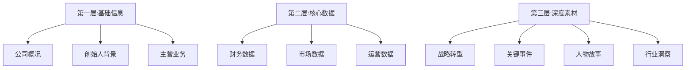
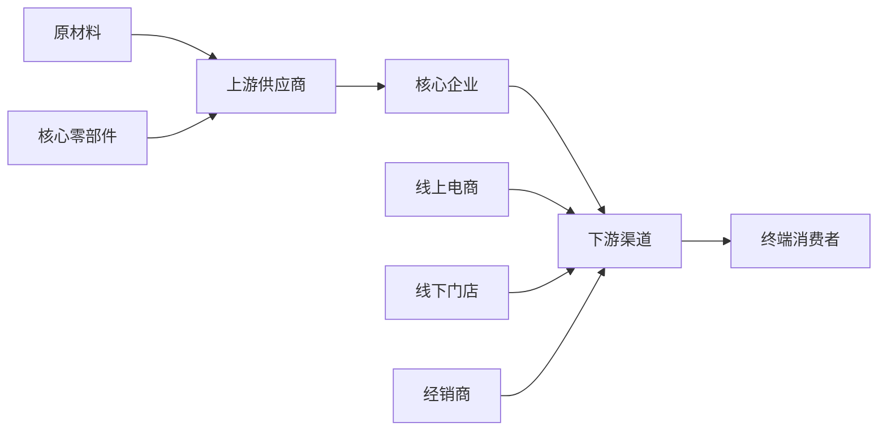

# 信息搜索方法论

## 一、搜索前的准备工作

### 1.1 明确研究对象和目标

在开始搜索前,先回答这些问题:

```markdown
## 研究对象定义清单

1. 研究主体是谁?
   - 公司全称/简称/英文名
   - 创始人姓名/核心高管
   - 主营业务/核心产品

2. 研究的时间范围?
   - 全生命周期(从成立至今)
   - 特定阶段(如2020-2023年转型期)
   - 某个关键节点(如上市前后)

3. 研究的核心问题?
   - 商业模式分析(如何赚钱)
   - 战略选择分析(为何成功/失败)
   - 行业地位分析(竞争格局)
   - 财务状况分析(盈利能力)

4. 预期产出是什么?
   - 5000字深度分析
   - 3000字快速解读
   - 系列专题报道
```

### 1.2 建立信息框架

**三层信息架构**:



### 1.3 搜索关键词库

**基础关键词**:
- 公司全称+简称(中英文)
- 创始人姓名
- 核心产品名称
- 行业通用术语

**组合关键词**:
- "公司名+财报"
- "公司名+融资"
- "公司名+上市"
- "公司名+战略"
- "创始人+访谈"
- "创始人+演讲"

**进阶关键词**:
- "公司名+竞争对手"
- "公司名+供应链"
- "公司名+专利"
- "行业名+发展史"
- "行业名+竞争格局"

## 二、企业基础信息收集

### 2.1 工商信息查询

**主要平台**: 天眼查、企查查、爱企查

**核心信息提取**:

```markdown
## 工商信息清单

### 基本信息
- 公司全称: [法定名称]
- 成立时间: YYYY-MM-DD
- 注册资本: XXX万元
- 法定代表人: [姓名]
- 实际控制人: [姓名/机构]

### 股权结构
- 大股东及持股比例
- 关键投资机构
- 股权变更历史

### 经营状况
- 主营业务(工商登记)
- 对外投资企业
- 分支机构/子公司

### 风险信息
- 法律诉讼
- 被执行人信息
- 行政处罚
- 经营异常
```

**搜索技巧**:
- 通过"股权穿透"找到实际控制人
- 通过"对外投资"了解业务版图
- 通过"历史变更"还原发展轨迹
- 通过"关联企业"发现潜在风险

### 2.2 财务信息获取

**上市公司**(信息最全):

**核心渠道**:
1. 交易所官网: 上交所/深交所/港交所
2. 巨潮资讯网: 中国上市公司信息披露平台
3. 公司官网投资者关系页面
4. Wind/同花顺等金融终端(付费)

**必读文件**:
- 年度报告(最详细)
- 季度报告(追踪变化)
- 招股说明书(了解历史)
- 财报电话会议纪要(管理层观点)

**非上市公司**(信息有限):

**可获取渠道**:
1. 企查查/天眼查的"经营状况"
2. 工商年报(可能不完整)
3. 投资机构的公开披露
4. 媒体报道中的数据

**财务数据提取模板**:

```markdown
## 财务数据提取模板

### 核心指标(近3年)
| 指标 | 2021 | 2022 | 2023 | 同比增长 |
|------|------|------|------|----------|
| 营业收入 | | | | |
| 净利润 | | | | |
| 毛利率 | | | | |
| 净利率 | | | | |
| 研发费用 | | | | |
| 销售费用 | | | | |

### 资产负债表关键项
- 总资产: 
- 总负债:
- 净资产:
- 资产负债率:

### 现金流量表关键项
- 经营活动现金流净额:
- 投资活动现金流净额:
- 筹资活动现金流净额:

### 重要财务比率
- ROE(净资产收益率):
- ROIC(投资资本回报率):
- 流动比率:
- 速动比率:
```

### 2.3 创始人/高管背景调查

**信息来源**:

1. **公开履历**:
   - 公司官网"管理团队"页面
   - 上市公司公告(董事、高管简历)
   - LinkedIn/脉脉等职业社交平台

2. **深度访谈**:
   - 财经媒体专访(晚点、36氪、财新)
   - 行业峰会演讲实录
   - 视频访谈(YouTube、B站)

3. **历史报道**:
   - 早期创业报道(找到最初的媒体报道)
   - 人物特稿(深度人物刻画)
   - 校友会/企业家协会介绍

**人物背景提取模板**:

```markdown
## 创始人/CEO背景模板

### 基本信息
- 姓名: [中英文]
- 出生年份: YYYY年(X岁)
- 籍贯: [省份/城市]
- 教育背景: [本科/硕士/博士,院校+专业]

### 职业经历
- 毕业后第一份工作: [公司+职位+年份]
- 关键职业经历: [公司+职位+时间段+主要成就]
- 创业前身份: [公司高管/连续创业者/跨界创业]

### 创业历程
- 首次创业时间: YYYY年
- 创业契机: [为什么创业/发现了什么机会]
- 初始团队: [联合创始人背景]
- 融资历程: [天使轮-A轮-上市]

### 管理风格与理念
- 核心金句: ["XXX"(来源)]
- 决策风格: [强势/温和/数据驱动]
- 人才观: [对人才的要求和态度]
- 公开争议: [如有]

### 社会兼职与影响力
- 行业协会职务
- 政协/人大代表
- 公益活动参与
- 社交媒体影响力
```

## 三、行业背景研究

### 3.1 行业发展史梳理

**研究路径**:

1. **查找行业综述报告**
   - 券商研报(如中信证券、国泰君安的行业深度报告)
   - 咨询公司报告(如麦肯锡、波士顿的行业研究)
   - 行业协会白皮书

2. **梳理关键时间节点**
   ```markdown
   ## 行业发展史模板
   
   ### 萌芽期(YYYY-YYYY)
   - 标志性事件: [第一家公司成立/第一款产品]
   - 市场规模: [初期体量]
   - 核心玩家: [早期企业]
   
   ### 成长期(YYYY-YYYY)
   - 标志性事件: [行业爆发/政策支持]
   - 市场规模增长: [年复合增长率]
   - 竞争格局: [新进入者/洗牌]
   
   ### 成熟期(YYYY-至今)
   - 标志性事件: [市场饱和/巨头垄断]
   - 当前市场规模: [最新数据]
   - 未来趋势: [技术变革/新模式]
   ```

3. **对比国际市场经验**
   - 美国同类行业发展路径
   - 日本同类行业经验教训
   - 欧洲市场的差异化特点

### 3.2 竞争格局分析

**数据来源**:

1. **市场份额数据**:
   - IDC/Gartner/Canalys(IT行业)
   - 艾瑞咨询/易观分析(互联网行业)
   - 中怡康/奥维云网(家电行业)
   - 尼尔森/凯度(消费品行业)

2. **竞争格局梳理框架**:

```markdown
## 竞争格局分析模板

### 市场集中度
- CR3(前三名市占率之和): XX%
- CR5(前五名市占率之和): XX%
- 市场格局: [一超多强/群雄逐鹿/寡头垄断]

### 主要玩家对比
| 企业 | 市占率 | 核心优势 | 主要劣势 | 战略方向 |
|------|--------|----------|----------|----------|
| 公司A | 30% | | | |
| 公司B | 25% | | | |
| 公司C | 15% | | | |

### 竞争维度分析
- 价格竞争: [是否价格战/毛利率水平]
- 技术竞争: [研发投入/专利数量]
- 渠道竞争: [线上线下布局]
- 品牌竞争: [品牌溢价能力]

### 行业壁垒
- 技术壁垒: [高/中/低]
- 资金壁垒: [高/中/低]
- 牌照壁垒: [是否需要]
- 规模效应: [是否明显]
```

### 3.3 产业链研究

**研究框架**:



**信息收集清单**:

```markdown
## 产业链分析模板

### 上游供应商
- 核心供应商名单: [前5大]
- 议价能力: [强/中/弱]
- 供应集中度: [是否依赖单一供应商]
- 供应链风险: [如有]

### 下游渠道
- 渠道结构: [线上占比XX%, 线下占比XX%]
- 主要渠道商: [京东、天猫、经销商]
- 渠道费用率: [XX%]
- 渠道掌控力: [强/中/弱]

### 产业链地位
- 议价能力: [对上游/对下游]
- 利润分配: [占产业链总利润的XX%]
- 可替代性: [高/中/低]
```

## 四、关键事件研究

### 4.1 事件时间线构建

**搜索方法**:

1. **百度/谷歌时间筛选搜索**
   - 搜索"公司名+2020"(逐年搜索)
   - 使用"工具-时间范围"筛选

2. **企查查"企业动态"功能**
   - 自动整理融资、工商变更、新闻报道

3. **媒体数据库检索**
   - 晚点LatePost/36氪/财新的历史报道
   - 使用站内搜索功能

**事件时间线模板**:

```markdown
## 关键事件时间线

### 创立期(YYYY-YYYY)
- YYYY.MM: 公司成立,获天使轮融资XXX万
- YYYY.MM: 推出首款产品,获得XXX用户
- YYYY.MM: 完成A轮融资,估值达XXX亿

### 快速扩张期(YYYY-YYYY)
- YYYY.MM: 用户突破XXX万,成为行业第X
- YYYY.MM: 完成B轮/C轮融资,估值XXX亿
- YYYY.MM: 拓展新业务线/进入新市场

### 上市期/转型期(YYYY-YYYY)
- YYYY.MM: 提交IPO申请/宣布战略转型
- YYYY.MM: 成功上市,市值XXX亿
- YYYY.MM: [重大事件,如换帅/业务调整]

### 近期动态(YYYY-至今)
- YYYY.MM: [最新重要事件]
```

### 4.2 危机事件深度挖掘

**关键危机类型**:
- 财务危机(亏损、债务、裁员)
- 产品危机(质量问题、安全事故)
- 管理危机(内斗、离职、贪腐)
- 合规危机(监管处罚、法律诉讼)
- 舆情危机(公关灾难、信任崩塌)

**危机研究框架**:

```markdown
## 危机事件分析模板

### 事件概述
- 发生时间: YYYY.MM.DD
- 事件性质: [产品质量/财务危机/法律纠纷]
- 核心矛盾: [一句话概括]

### 事件还原
- 导火索: [什么引发了危机]
- 发酵过程: [如何从小事变成大事]
- 舆论反应: [媒体/用户的态度]
- 监管介入: [是否有官方调查]

### 公司应对
- 首次回应时间: [危机发生后XX小时]
- 回应态度: [道歉/辟谣/沉默]
- 实际行动: [召回/赔偿/整改]
- 高管表态: [CEO/董事长的公开发言]

### 事件影响
- 短期影响: [股价/营收/用户流失]
- 长期影响: [品牌形象/竞争地位]
- 行业影响: [是否引发监管/行业洗牌]

### 信源清单
- [ ] 官方公告
- [ ] 媒体报道(至少3家独立信源)
- [ ] 法院判决书(如涉及诉讼)
- [ ] 监管部门通报
```

## 五、数据可视化来源

### 5.1 财务数据可视化

**工具推荐**:
- 雪球/东方财富: 自动生成K线图、财务指标对比图
- Wind/同花顺: 专业金融图表
- Excel/Numbers: 自制图表

**常用图表类型**:

```markdown
## 财务数据可视化清单

### 营收增长趋势
- 图表类型: 柱状图+折线图(营收用柱状图,增长率用折线)
- 时间跨度: 近5年(按年)或近8个季度(按季)
- 数据来源: [财报名称+页码]

### 利润结构对比
- 图表类型: 堆叠柱状图
- 对比维度: 毛利/营业利润/净利润
- 数据来源: [财报名称+页码]

### 业务板块收入占比
- 图表类型: 饼图或环形图
- 展示内容: 各业务板块营收占比
- 数据来源: [财报名称+分部报告页码]

### 与竞争对手对比
- 图表类型: 雷达图或分组柱状图
- 对比指标: 营收/利润/研发投入/市值
- 数据来源: [多家公司财报]
```

### 5.2 市场数据可视化

**数据来源**:
- IDC/Gartner/Canalys: IT行业市场份额
- 艾瑞/易观: 互联网行业用户规模
- 国家统计局: 宏观经济数据
- 行业协会: 产销量数据

**可视化示例**:

```markdown
## 市场数据可视化清单

### 市场份额变化
- 图表类型: 堆叠面积图
- 展示内容: TOP5企业市占率变化(2019-2023)
- 数据来源: [IDC中国XX市场季度报告]

### 行业规模增长
- 图表类型: 柱状图+折线图
- 展示内容: 市场规模(柱状)+ 增长率(折线)
- 数据来源: [行业协会/咨询公司报告]

### 用户画像分布
- 图表类型: 多个饼图或条形图
- 展示内容: 年龄/性别/地域/消费能力分布
- 数据来源: [QuestMobile/艾瑞用户洞察报告]
```

## 六、素材管理系统

### 6.1 素材分类存储

**文件夹结构建议**:

```
[公司名]_[YYYY-MM-DD]
├── 01_基础信息
│   ├── 工商信息.pdf
│   ├── 公司简介.docx
│   └── 高管履历.xlsx
├── 02_财务数据
│   ├── 2023年年报.pdf
│   ├── 2023Q1-Q4季报.pdf
│   └── 财务数据提取表.xlsx
├── 03_媒体报道
│   ├── 晚点_XXX报道.pdf
│   ├── 36氪_XXX专访.pdf
│   └── 报道清单.xlsx
├── 04_研报资料
│   ├── 中信证券_行业深度.pdf
│   ├── 国泰君安_公司研究.pdf
│   └── 研报摘要.docx
├── 05_数据图表
│   ├── 营收增长趋势.png
│   ├── 市场份额对比.png
│   └── 图表数据源.xlsx
└── 06_参考文献
    └── 引用清单.xlsx
```

### 6.2 素材清单模板

**Excel表格管理**(推荐):

```markdown
## 素材管理表(Excel模板)

| 序号 | 素材类型 | 具体内容 | 来源 | 文件路径/链接 | 提取时间 | 可信度 | 是否已用 | 备注 |
|------|----------|----------|------|---------------|----------|--------|----------|------|
| 1 | 财务数据 | 2023年营收2709亿 | 小米年报P.3 | /02_财务数据/2023年报.pdf | 2024-01-28 | ★★★★★ | 是 | 核心数据 |
| 2 | 人物引语 | "创新是小米生命线" | 2023发布会 | https://... | 2024-01-28 | ★★★★★ | 是 | 00:12:34 |
| 3 | 市场数据 | 市占率14.5% | IDC报告 | /04_研报资料/IDC_Q4.pdf | 2024-01-28 | ★★★★☆ | 否 | 中国市场 |
| 4 | 事件描述 | 2023年进入汽车市场 | 36氪报道 | https://... | 2024-01-28 | ★★★★☆ | 否 | 需交叉验证 |
```

**可信度评级标准**:
- ★★★★★: 官方财报、政府文件、法院判决
- ★★★★☆: 权威媒体报道、券商研报、公司官宣
- ★★★☆☆: 一般媒体报道、行业专家观点
- ★★☆☆☆: 自媒体文章、社交媒体(需验证)
- ★☆☆☆☆: 匿名爆料、道听途说(慎用)

### 6.3 写作素材速查表

**按写作模块分类**:

```markdown
## 写作素材速查表

### 开篇引子素材
- [ ] 戏剧化场景: [最新重大事件/冲突瞬间]
- [ ] 震撼数据: [营收破XXX亿/用户达XXX亿]
- [ ] 对比反差: [曾经辉煌vs如今困境]

### 背景铺陈素材
- [ ] 行业发展史: [关键时间节点3-5个]
- [ ] 公司成长史: [创立-融资-上市-转型]
- [ ] 竞争格局: [TOP5企业市占率]

### 正文论证素材
- [ ] 财务数据: [近3年营收/利润/增长率]
- [ ] 战略案例: [关键决策3-5个]
- [ ] 人物故事: [创始人/核心高管经历]
- [ ] 产品数据: [销量/用户数/复购率]

### 结尾升华素材
- [ ] 行业趋势: [未来3-5年发展方向]
- [ ] 哲理金句: [管理者名言/行业洞察]
- [ ] 悬念留白: [未解决的问题/新的挑战]
```

## 七、搜索效率提升技巧

### 7.1 高级搜索技巧

**谷歌/百度高级搜索**:

```markdown
## 搜索指令清单

### 精确匹配
- "小米2023年营收" → 包含完整关键词的结果

### 排除关键词
- 小米 -小米粥 → 排除无关结果

### 站内搜索
- site:latepost.com 小米 → 只搜索晚点网站

### 文件类型搜索
- 小米财报 filetype:pdf → 只搜索PDF文件

### 时间范围搜索
- 工具-时间范围-自定义(2023.01.01-2023.12.31)

### 标题搜索
- intitle:小米财报 → 标题包含关键词

### 组合搜索
- site:weibo.com 雷军 "小米汽车" → 微博上雷军关于小米汽车的发言
```

### 7.2 搜索资源推荐

**中文资源**:

| 资源类型 | 平台名称 | 主要用途 | 是否付费 |
|----------|----------|----------|----------|
| 财经媒体 | 晚点LatePost、36氪、财新 | 深度报道、独家消息 | 部分付费 |
| 数据平台 | 天眼查、企查查 | 工商信息、股权结构 | 基础免费 |
| 财报平台 | 巨潮资讯网、同花顺 | 上市公司财报 | 免费 |
| 研报平台 | Wind、萝卜投研 | 券商研报、行业分析 | 付费 |
| 行业数据 | 艾瑞、易观、QuestMobile | 互联网行业数据 | 部分付费 |
| 学术资源 | 知网、万方 | 学术论文、行业研究 | 付费 |

**英文资源**:

| 资源类型 | 平台名称 | 主要用途 | 是否付费 |
|----------|----------|----------|----------|
| 财经媒体 | Bloomberg、WSJ、FT | 国际商业报道 | 付费 |
| 数据平台 | Crunchbase | 创业公司融资信息 | 部分付费 |
| 市场研究 | Gartner、IDC、Forrester | 市场份额、趋势预测 | 付费 |
| 公司信息 | SEC(美国证监会) | 美股上市公司财报 | 免费 |
| 行业数据 | Statista | 全球统计数据 | 部分付费 |

### 7.3 时间管理建议

**素材收集时间分配**:

```markdown
## 时间分配建议(总计8-12小时)

### Day 1: 基础信息收集(2-3小时)
- 工商信息: 30分钟
- 财报下载和关键数据提取: 60分钟
- 创始人/高管背景: 30分钟
- 公司大事记: 30分钟

### Day 2: 深度素材挖掘(3-4小时)
- 媒体深度报道阅读: 90分钟
- 券商研报阅读: 60分钟
- 行业背景研究: 60分钟
- 竞品分析: 30分钟

### Day 3: 补充和验证(2-3小时)
- 数据交叉验证: 60分钟
- 素材分类整理: 30分钟
- 引用来源记录: 30分钟
- 写作大纲搭建: 60分钟

### Day 4-5: 边写边查(持续)
- 遇到不确定的内容立即查证
- 补充缺失的数据和案例
- 完善参考文献列表
```

## 八、常见问题与解决方案

### 8.1 信息不足怎么办?

**问题**: 非上市公司财务数据无法获取

**解决方案**:
1. 通过融资新闻推算估值和体量
2. 从行业报告中找到市占率,反推营收
3. 从招聘信息推算人员规模
4. 从供应商/客户财报中找到关联交易数据
5. 直接联系公司PR部门申请数据

**问题**: 关键事件细节不清晰

**解决方案**:
1. 查找当时的多篇报道,交叉对比
2. 搜索当事人的微博/朋友圈(如有)
3. 在知乎/脉脉搜索相关讨论(谨慎采信)
4. 联系行业专家/前员工访谈

### 8.2 信息冲突怎么办?

**问题**: 不同信源的数据不一致

**解决方案**:
1. 优先采用一级信源(财报、官方文件)
2. 检查统计口径是否一致(如"中国市场"vs"全球市场")
3. 检查时间节点是否一致(如"2023年"vs"2023Q4")
4. 如无法确认,标注"据XX统计"并说明差异

**问题**: 媒体报道与官方说法矛盾

**解决方案**:
1. 呈现双方观点,不强行判断
2. 提供判断依据,让读者自己思考
3. 如有第三方证据(如法院判决),以证据为准

### 8.3 时间不够怎么办?

**快速搜索法(3小时速成)**:

```markdown
## 3小时快速搜索清单

### 第1小时: 核心数据(必须)
- [ ] 天眼查/企查查: 基本信息+股权结构(15分钟)
- [ ] 财报/融资新闻: 核心财务数据(30分钟)
- [ ] 公司官网: 业务介绍+管理团队(15分钟)

### 第2小时: 关键素材(重点)
- [ ] 搜索"公司名+深度"/"公司名+专访": 找2-3篇深度报道(45分钟)
- [ ] 搜索"创始人+访谈"/"创始人+演讲": 找金句和观点(15分钟)

### 第3小时: 补充验证(查漏补缺)
- [ ] 竞品对比: 找TOP3竞争对手的关键数据(20分钟)
- [ ] 行业背景: 快速读1份券商行业报告(30分钟)
- [ ] 数据验证: 交叉核查核心数据(10分钟)
```

---

**搜索金句**:

> "好的商业写作,80%的时间在搜索和整理素材,20%的时间在写作和打磨。"

> "不要急着动笔,先让素材在你的大脑里沉淀48小时,框架会自然浮现。"
