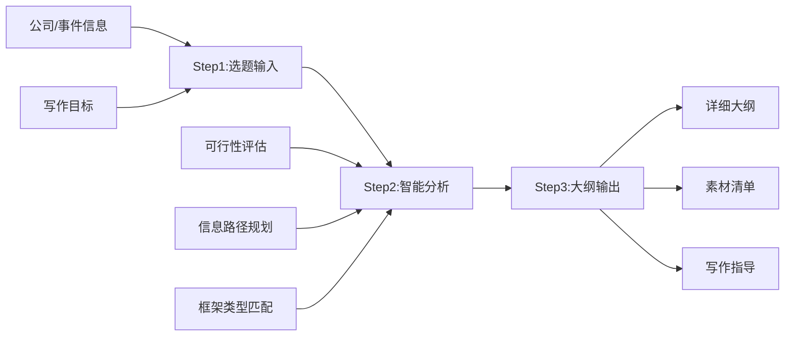

# 框架生成器:从选题到大纲的全流程指南

## 一、框架生成器使用流程

### 1.1 系统概述

框架生成器是一个**交互式工具**,帮助你在30分钟内完成从选题确认到详细大纲的全流程。它整合了前面所有知识库的精华,通过结构化问答生成定制化的写作框架。

**核心功能**:
1. 选题可行性评估
2. 信息收集路径图生成
3. 文章大纲自动生成
4. 写作指导清单输出
5. 素材管理模板提供

### 1.2 三步生成法



## 二、Step 1: 选题信息收集

### 2.1 基础信息表单

请回答以下问题(越详细越好):

```markdown
## 选题基础信息

### 1. 研究对象
- 公司/事件全称: [如:小米集团/京东百亿补贴]
- 所属行业: [如:消费电子/电商]
- 当前状态: [上市/非上市/新闻热点]

### 2. 写作动机
- 选题契机: [财报发布/重大事件/行业趋势]
- 核心问题: [想解答什么问题,1-2句话]
- 目标读者: [创业者/投资人/普通读者]

### 3. 时间范围
- 重点时期: [全生命周期/近3年/某个转折点]
- 截止时间: [最新到何时的信息]

### 4. 预期产出
- 目标字数: [3000字/5000字/8000字]
- 完成时限: [X天]
- 文章定位: [深度分析/快速解读/系列专题]
```

### 2.2 选题类型判断

根据研究对象和核心问题,系统会自动判断文章类型:

| 类型 | 特征 | 典型案例 | 推荐字数 |
|------|------|----------|----------|
| **财报分析类** | 基于最新财报,分析经营状况 | 《小米:日子过得不好,但我还有救》 | 3000-5000字 |
| **战略分析类** | 聚焦企业战略选择和竞争策略 | 《京东的低价长跑》 | 5000-6000字 |
| **企业兴衰类** | 梳理企业发展史,分析成败原因 | 《谁打垮了江小白》 | 5000-8000字 |
| **行业趋势类** | 分析行业变革和未来方向 | 《新能源车的下半场》 | 5000-7000字 |
| **人物传记类** | 聚焦创始人/CEO的成长和决策 | 《雷军这十年》 | 6000-8000字 |
| **商业模式类** | 拆解企业如何赚钱和创造价值 | 《瑞幸的瓶颈期》 | 4000-6000字 |
| **事件复盘类** | 还原重大商业事件来龙去脉 | 《特斯拉降价风波》 | 3000-5000字 |

## 三、Step 2: 智能分析

### 3.1 可行性评估

系统会从三个维度评估选题可行性:

**维度1: 信息丰富度** (⭐⭐⭐⭐⭐ 满分5星)

- ⭐⭐⭐⭐⭐: 上市公司+近期财报+多篇深度报道
- ⭐⭐⭐⭐☆: 上市公司但财报较旧/非上市但有详细融资信息
- ⭐⭐⭐☆☆: 有基础工商信息+部分媒体报道
- ⭐⭐☆☆☆: 信息稀缺,只有零星报道
- ⭐☆☆☆☆: 几乎无公开信息

**建议**: ⭐⭐⭐以上可以写,⭐⭐以下建议换选题

**维度2: 时效性** (高/中/低)

- **高**: 近1个月内有重大事件(财报/融资/危机/战略调整)
- **中**: 近3-6个月内有新动向
- **低**: 无最新动态,纯历史回顾

**建议**: 时效性高更容易传播,但低时效性不影响深度价值

**维度3: 争议性/话题性** (高/中/低)

- **高**: 舆论关注度高,有多方观点碰撞
- **中**: 行业内关注,但大众认知不足
- **低**: 小众话题,受众有限

**建议**: 争议性高更易传播,但需要更谨慎的事实核查

### 3.2 信息收集路径图

根据选题类型,系统会生成定制化的信息收集清单:

**示例: 财报分析类信息收集清单**

```markdown
## 信息收集清单(财报分析类)

### 阶段1: 核心数据(必须,2小时)
- [ ] 最新财报(年报/季报)PDF下载
- [ ] 提取核心数据:营收/利润/增长率/毛利率/净利率
- [ ] 财报电话会议纪要(管理层观点)
- [ ] 同期竞争对手财报(对比)

### 阶段2: 背景信息(必须,1小时)
- [ ] 公司简介(官网/百科)
- [ ] 主营业务和产品线
- [ ] 创始人/CEO背景
- [ ] 行业地位和市占率

### 阶段3: 深度素材(建议,2-3小时)
- [ ] 券商研报(2-3份)
- [ ] 媒体深度报道(晚点/36氪,2-3篇)
- [ ] 行业发展趋势报告
- [ ] 竞争格局分析

### 阶段4: 辅助材料(可选,1小时)
- [ ] 创始人访谈/演讲视频
- [ ] 用户/员工评价(脉脉/知乎)
- [ ] 历史争议事件
```

### 3.3 框架类型匹配

系统会根据选题特征,推荐最合适的文章框架:

**框架1: 问题-分析-案例(PAC)框架**

**适用**: 财报分析类、战略分析类
**结构**:
1. 开篇:抛出核心矛盾/问题
2. 问题分析:为什么会这样?(数据+逻辑)
3. 案例支撑:其他公司的类似经历
4. 解决方案:公司如何应对?
5. 结尾:未来展望

**框架2: 时间线叙事(Timeline)框架**

**适用**: 企业兴衰类、人物传记类
**结构**:
1. 开篇:最戏剧化的时刻
2. 回溯:创立期的初心和选择
3. 发展:快速扩张的关键节点
4. 转折:危机或战略调整
5. 现状:当下面临的挑战
6. 结尾:历史的启示

**框架3: 对比论证(Comparison)框架**

**适用**: 行业趋势类、商业模式类
**结构**:
1. 开篇:行业现状的矛盾点
2. 对比1:不同公司的战略差异
3. 对比2:不同模式的利弊分析
4. 对比3:中国vs国际经验
5. 结尾:趋势判断

**框架4: 解构重组(Deconstruction)框架**

**适用**: 商业模式类、战略分析类
**结构**:
1. 开篇:表象与本质的反差
2. 解构1:商业模式的核心要素
3. 解构2:竞争优势的来源
4. 解构3:风险和隐忧
5. 重组:全景式评估
6. 结尾:价值判断

## 四、Step 3: 大纲自动生成

### 4.1 标准5000字文章大纲模板

系统会根据前面的输入,自动生成详细大纲:

```markdown
# [文章标题](系统生成3个候选标题)

## 候选标题
1. [判断句式] 如:"京东的低价,是一场没有尽头的长跑"
2. [疑问句式] 如:"低价能救京东吗?"
3. [数据震撼式] 如:"百亿补贴背后,京东在赌什么?"

**推荐**: [标题1] (理由:XXX)

---

## 一、开篇引子 (300-400字)

**切入手法**: [戏剧化场景/对比反差/数据震撼]

**具体内容**:
- [场景/数据/对比描述]
- 核心矛盾:[一句话概括]
- 情感基调:[克制/紧张/悲壮]

**参考案例**: [相似案例链接]

**写作指导**:
- ✅ 要有具体时间、地点、人物
- ✅ 要制造悬念或冲突
- ❌ 不要过度煽情
- ❌ 不要堆砌形容词

---

## 二、背景铺陈 (500-800字)

**核心任务**: 为不了解该行业/公司的读者建立基础认知

**具体内容**:
1. 公司基本信息(1-2句话,50字)
   - 创立时间/创始人/主营业务/当前地位
2. 行业背景(300-400字)
   - 行业发展史关键节点(3-5个)
   - 当前竞争格局(TOP3-5企业)
   - 行业趋势(一句话)
3. 引出问题(100-150字)
   - 为什么在这个时间点讨论这家公司?
   - 它面临的核心挑战是什么?

**数据需求**:
- [ ] 公司成立时间
- [ ] 创始人姓名
- [ ] 当前营收/市值/用户数(选一个核心指标)
- [ ] 行业TOP3-5企业名称和市占率
- [ ] 行业规模和增长率

**写作指导**:
- ✅ 用时间线串联关键事件
- ✅ 数据要有对比(同比/环比/与竞品对比)
- ❌ 不要流水账罗列
- ❌ 不要过早下结论

---

## 三、正文模块1: [小标题] (800-1200字)

**小标题参考**:
- [如果是财报分析] "风光的营收,惨淡的利润"
- [如果是战略分析] "低价背后的供应链战争"
- [如果是企业兴衰] "巅峰时刻:XXX的选择"

**具体内容**:
1. 分论点陈述(100字)
   - 用1-2句话清晰表达本段核心观点
2. 数据支撑(300-400字)
   - 核心数据(2-3个)
   - 数据对比(同比/竞品/历史)
   - 数据具象化呈现
3. 案例展开(300-400字)
   - 具体事件/产品/决策
   - 细节描写
   - 人物引语(如有)
4. 小结过渡(100-150字)
   - 回扣分论点
   - 承上启下,引出下一段

**数据需求**:
- [ ] 核心数据X
- [ ] 对比数据Y
- [ ] 辅助数据Z

**写作指导**:
- ✅ 观点-数据-案例-小结的逻辑链条
- ✅ 长短句交替,控制节奏
- ❌ 不要只有数据没有分析
- ❌ 不要跳跃太大,逻辑断裂

---

## 四、正文模块2: [小标题] (800-1200字)

[结构同上]

---

## 五、正文模块3: [小标题] (800-1200字)

[结构同上]

---

## 六、结尾升华 (300-500字)

**结尾类型**: [哲理升华/展望未来/人文关怀/反问留白]

**具体内容**:
1. 回扣主题(100字)
   - 不要简单重复开篇
   - 用新的角度重新审视
2. 哲理升华(150-200字)
   - 从具体案例上升到普遍规律
   - 给读者启发和思考
   - 可适当使用金句
3. 留有余韵(50-100字)
   - 悬念:未解决的问题
   - 展望:未来可能的方向
   - 反问:引发读者思考

**金句候选**:
- [系统根据文章主题生成2-3个金句候选]

**写作指导**:
- ✅ 要有深度,不要浅尝辄止
- ✅ 要有温度,不要冷冰冰
- ❌ 不要重复正文内容
- ❌ 不要刻意拔高,为赋新词强说愁

---

## 七、参考文献与数据来源

**必须标注的信源**:
- [ ] 财报/官方文件
- [ ] 权威媒体报道
- [ ] 券商研报/行业报告
- [ ] 人物访谈/演讲

**格式规范**: 参考《事实核查标准》中的参考文献格式

---

## 八、写作检查清单

### 结构检查
- [ ] 开篇是否有吸引力?(戏剧化/对比/数据震撼)
- [ ] 背景铺陈是否清晰?(不了解的读者能看懂吗)
- [ ] 正文逻辑是否连贯?(论点-论据-结论)
- [ ] 结尾是否有升华?(不是简单总结)

### 内容检查
- [ ] 核心数据是否准确?(已交叉验证)
- [ ] 引用是否有出处?(能追溯到原始信源)
- [ ] 案例是否充分?(每个论点都有支撑)
- [ ] 观点是否客观?(避免过度主观判断)

### 语言检查
- [ ] 长短句比例是否合理?(7:3黄金比例)
- [ ] 段落长度是否层次分明?(长中短搭配)
- [ ] 数据呈现是否艺术化?(具象化、对比、类比)
- [ ] 金句是否恰当?(2-4个,不滥用)

### 事实检查
- [ ] 所有数据都有来源标注
- [ ] 所有时间节点已核实
- [ ] 所有人名/公司名无错别字
- [ ] 争议性内容已标注"有观点认为"
```

### 4.2 快速3000字文章大纲模板

如果时间紧迫或选题信息有限,可以使用精简版:

```markdown
# [文章标题]

## 一、开篇 (200-300字)
- 核心矛盾/最新动态
- 一句话引出主题

## 二、核心问题分析 (800-1000字)
- 问题是什么?(数据呈现)
- 为什么会这样?(逻辑分析)
- 对比:其他公司如何做?

## 三、深层原因 (800-1000字)
- 战略层面
- 组织层面
- 行业层面

## 四、未来展望 (300-400字)
- 可能的解决方案
- 行业趋势判断
- 留白/反问

## 五、参考文献
```

## 五、分场景应用示例

### 5.1 财报分析类示例

**输入信息**:
- 公司:小米集团
- 事件:2023年年报发布
- 核心问题:营收增长但利润下滑,为什么?

**系统输出**:

```markdown
# 小米:日子过得不好,但我还有救

## 一、开篇(对比反差) 300字
"2023年,小米营收2709亿,重回全球手机前三;但扣除投资收益后,经营利润同比暴跌67%,十年来最惨烈的一次。雷军在发布会上谈笑风生,财报电话会上却坦承'手机业务压力巨大'。这是小米最分裂的一年:表面风光,内里焦虑。"

## 二、背景铺陈 600字
1. 小米基本信息(100字)
2. 2023年手机行业格局(300字)
   - 全球手机出货量下滑3.2%
   - 中国市场竞争白热化:华为回归+荣耀崛起
   - 高端化成为行业共识
3. 引出问题(200字)
   - 小米为什么增收不增利?
   - 高端化战略遇到了什么困境?

## 三、正文模块1: "风光的营收,惨淡的利润" 1000字
1. 数据拆解(400字)
   - 营收2709亿(+4.9%),但经营利润暴跌67%
   - 手机ASP(平均售价)下滑,低端机占比上升
   - 毛利率20.8%,低于苹果(45%)和华为(40%)
2. 原因分析(400字)
   - 高端机(4000+)销量不及预期,小米14系列遇冷
   - 中低端市场价格战激烈,被迫降价保份额
   - 研发和营销费用大增,侵蚀利润
3. 小结(200字)
   - 小米陷入"高不成低不就"的尴尬境地

## 四、正文模块2: "高端化的困境" 1000字
1. 小米高端化三年回顾(300字)
   - 2021:小米11冲击高端
   - 2022:小米12系列+徕卡加持
   - 2023:小米14系列澎湃OS
2. 为什么高端化这么难?(500字)
   - 品牌认知壁垒:用户心智难改变
   - 产品力不足:对比iPhone和华为Mate
   - 渠道劣势:线下门店覆盖不足
3. 竞品对比(200字)
   - vivo/OPPO的高端化路径
   - 华为回归的冲击

## 五、正文模块3: "造车是解药还是毒药" 1000字
1. 小米汽车进展(300字)
   - 累计投入100亿
   - 预计2024年Q1交付
   - 目标:年销10万辆
2. 造车的机会(300字)
   - 新能源车高端市场空间大
   - 小米生态优势
   - 雷军的决心和资源投入
3. 造车的风险(400字)
   - 短期继续亏损,拖累财报
   - 竞争激烈,成功不确定
   - 分散管理层精力

## 六、结尾升华 400字
1. 回扣主题(150字)
   - 小米当下很难,但未来有希望
   - 手机业务需要突破,汽车业务需要耐心
2. 哲理升华(200字)
   - "所有的伟大公司,都曾经历至暗时刻"
   - 小米的韧性在于:不放弃高端梦,不放弃技术投入
3. 留白(50字)
   - "小米汽车能救小米吗?2024年见分晓"

## 七、参考文献
- 小米集团2023年年报
- IDC中国手机市场报告
- 晚点《小米造车三年》
- 中信证券《小米深度研究》
```

### 5.2 企业兴衰类示例

**输入信息**:
- 公司:江小白
- 事件:陷入经营困境,被列为被执行人
- 核心问题:曾经的白酒新星,为何陨落?

**系统输出**:

```markdown
# 谁打垮了江小白?

## 一、开篇(戏剧化场景) 350字
"2023年10月,重庆江小白酒业出现在被执行人名单上,执行标的1.09亿元。这家曾经估值超过100亿、被称为'白酒行业小米'的公司,最终还是没能穿越周期..."

## 二、背景铺陈 700字
1. 江小白的巅峰(2015-2018)
2. 白酒行业格局:传统vs新消费
3. 引出问题:江小白到底做错了什么?

## 三、时间线叙事
- 模块1: "意外走红"(2012-2015) 1000字
- 模块2: "膨胀与冒进"(2016-2019) 1000字
- 模块3: "溃败始末"(2020-2023) 1000字

## 四、深层原因剖析 1000字
1. 产品力不足:口感不佳,复购率低
2. 营销透支:情怀消费不可持续
3. 渠道失控:经销商库存积压
4. 战略失误:盲目多元化

## 五、结尾:新消费的教训 400字
"江小白的失败,不是情怀的失败,而是对商业规律的轻视..."
```

## 六、素材管理模板同步生成

系统会同步生成配套的素材管理表格:

```markdown
## 素材收集清单(Excel模板)

| 模块 | 具体内容 | 信息来源 | 优先级 | 完成状态 |
|------|----------|----------|--------|----------|
| 开篇 | 2023年最新营收数据 | 小米年报P.3 | 高 | □ |
| 开篇 | 经营利润同比跌幅 | 小米年报P.15 | 高 | □ |
| 背景 | 2023全球手机出货量 | IDC报告 | 高 | □ |
| 背景 | 中国TOP5品牌市占率 | Canalys报告 | 高 | □ |
| 模块1 | 小米ASP数据 | 年报业务分析 | 高 | □ |
| 模块1 | 小米14系列销量 | 媒体报道 | 中 | □ |
| 模块2 | 高端机销量占比 | 券商研报 | 中 | □ |
| 模块2 | 雷军关于高端化发言 | 发布会视频 | 中 | □ |
| 模块3 | 小米汽车投入 | 年报+新闻 | 高 | □ |
| 结尾 | 对标企业案例 | 研报/案例库 | 低 | □ |
```

## 七、写作时间规划

系统会提供详细的时间分配建议:

```markdown
## 写作时间规划(5000字文章,总计2-3天)

### Day 1: 素材收集+框架搭建 (4-6小时)
- 09:00-11:00  核心数据收集(财报/研报)
- 11:00-12:00  媒体报道阅读
- 14:00-16:00  补充素材+数据验证
- 16:00-17:00  完善大纲,确定每段核心观点

### Day 2: 正文写作 (6-8小时)
- 09:00-10:30  背景铺陈(相对简单,先写)
- 10:30-12:00  正文模块1
- 14:00-16:00  正文模块2
- 16:00-18:00  正文模块3
- 19:00-20:00  开篇引子(放在后面写,此时思路最清晰)

### Day 3: 打磨收尾 (4-5小时)
- 09:00-10:30  结尾升华
- 10:30-11:30  第一轮修改(结构+逻辑)
- 14:00-15:00  第二轮修改(语言+节奏)
- 15:00-16:00  第三轮修改(数据+事实核查)
- 16:00-17:00  参考文献整理+终稿检查
```

## 八、常见问题与解决方案

### Q1: 素材不足,大纲无法填充怎么办?

**解决方案**:
1. 调整文章类型(如从8000字深度改为5000字解读)
2. 缩小研究范围(如从全生命周期聚焦到近3年)
3. 增加对比维度(如加入竞品对比,丰富内容)
4. 延长素材收集时间,挖掘更多信源

### Q2: 大纲看起来很散,逻辑不连贯?

**解决方案**:
1. 检查每个模块是否都回扣核心问题
2. 加强段落间的过渡句
3. 确保每个模块的小标题呼应总标题
4. 用一句话梳理全文逻辑主线

### Q3: 不知道选哪个开篇手法?

**建议**:
- 如果有戏剧化事件→用场景切入
- 如果数据反差大→用对比切入
- 如果有惊人数字→用数据震撼
- 都不明显→用对比切入(最保险)

### Q4: 结尾升华太难,写不出深度?

**解决方案**:
1. 从具体到抽象:从案例上升到规律
2. 从过去到未来:从历史教训到趋势展望
3. 从公司到行业:从个体困境到共性问题
4. 反问留白:抛出未解决的问题

---

**框架生成器金句**:

> "好的大纲是成功的一半。花1小时做大纲,能节省3小时写作时间。"

> "框架是骨架,素材是血肉,文风是灵魂。三者缺一不可。"

---

**附录**: 
- [标题公式速查表](01-writing-methodology.md#标题公式库)
- [开篇手法深度拆解](07-style-training-advanced.md#二开篇引子深度训练)
- [事实核查清单](04-fact-checking-standards.md)
- [信息搜索路径](06-information-search-methodology.md)
